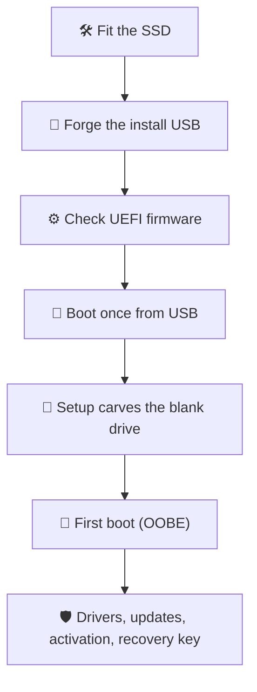
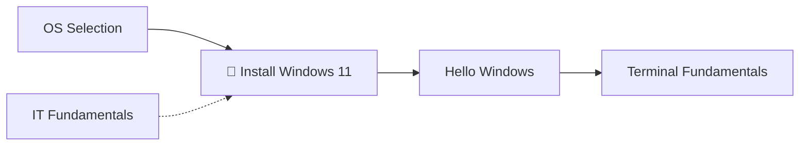

*A laptop with a brand-new SSD is gear without a world. The fans spin, the screen glows, and the firmware searches every corner for something to boot — and finds nothing. This quest teaches you the summoning: a USB stick carrying Windows 11, a few careful choices in the firmware, and a Setup wizard that carves an empty drive into a living World.*

*You will finish with a fortress you built from bare metal: Windows 11 installed, activated, patched, encrypted, and with its recovery key stored somewhere safe.*

## 📖 The Legend Behind This Quest

*Every IT practitioner eventually performs this rite. A drive fails and gets replaced. A laptop gets a bigger SSD. A machine is wiped for a new owner, or rescued from malware that no cleaner can remove. Each time, the job is the same: put a World onto empty storage and make it trustworthy.*

*Doing it once by hand teaches you the layers that every computer stacks on top of each other: **firmware** (UEFI) wakes the hardware and picks something to boot, a **boot loader** on the USB starts a tiny installer environment, the **installer** partitions the disk and copies Windows onto it, and the **out-of-box experience** (OOBE) turns a copied World into *your* World. Once you can see those layers, most "my PC won't start" mysteries stop being mysteries.*

## 🎯 Quest Objectives

By the end of this quest you will have:

- [ ] **Fitted the gear** — installed a new SSD of the right size and interface
- [ ] **Forged the install USB** — built bootable Windows 11 media on Windows, macOS or Linux and verified the download
- [ ] **Commanded the firmware** — confirmed UEFI mode, Secure Boot and TPM 2.0, then booted once from USB
- [ ] **Carved the empty drive** — let Setup build a GPT partition layout on unallocated space, loading a storage driver if needed
- [ ] **Survived first boot** — completed the OOBE, including network, account and privacy choices
- [ ] **Raised the fortress walls** — installed drivers and updates, confirmed activation, and saved the BitLocker recovery key off the machine

## 🗺️ Quest Prerequisites

### 📋 Knowledge Requirements

- [ ] You can download a file and find it in your Downloads folder
- [ ] You know your laptop's **manufacturer and exact model** (it's on a sticker underneath, or in the original box) — you'll need it for the service manual and drivers

### 🛠️ Gear Checklist

- [ ] **The laptop** — it must meet Windows 11's [minimum requirements](https://www.microsoft.com/en-us/windows/windows-11-specifications): a 64-bit 1 GHz dual-core CPU, 4 GB RAM, 64 GB storage, UEFI firmware with Secure Boot, TPM 2.0, and a DirectX 12 graphics chip. Almost every laptop sold since 2019 qualifies.
- [ ] **The new SSD** — 64 GB is the floor; 256 GB or more is comfortable. Chapter 1 shows how to pick one that fits.
- [ ] **A USB flash drive** — 8 GB is Microsoft's minimum for the Media Creation Tool, but a **16 GB or larger** stick also fits the full ISO. Everything on it will be erased.
- [ ] **A second computer** with internet access, to download Windows and build the USB.
- [ ] **An internet connection for the laptop** during first boot — Windows 11 Home and Pro (personal use) require it, along with a Microsoft account.
- [ ] **A product key or digital license** — most laptops that shipped with Windows carry their key inside the firmware, so you won't need to type one.
- [ ] **Tools** — a small Phillips screwdriver (sometimes Torx), a plastic pry tool or old guitar pick, and a well-lit table.

> ⚠️ **Choose your drive with care.** Setup erases whatever drive you point it at. This quest assumes the SSD is brand new and empty. If you are reusing a drive or replacing one that holds data you need, back that data up on another device first.

> 💡 **Arm laptops (Snapdragon X and similar):** Microsoft's Media Creation Tool only builds media for x64 PCs. Download the Arm64 ISO from Microsoft's [Arm64 download page](https://www.microsoft.com/software-download/windows11arm64) and use the macOS, Linux or Rufus path below. Arm laptops depend heavily on the manufacturer's drivers, so check its support page before you start.

### ⏱️ Time Budget

| Stage | Typical time |
|---|---|
| Download the ISO or run the Media Creation Tool | 15–45 minutes (depends on your connection) |
| Fit the SSD and check the firmware | 20–30 minutes |
| Setup copies Windows to the SSD | 15–30 minutes |
| First boot (OOBE) | 10–20 minutes |
| Updates, drivers and checks | 30–60 minutes |

## 🧭 The Summoning Path

Here is the whole journey at a glance. Each box is a chapter below.



## 🌍 Choose Your Adventure Platform

The install USB is forged on whatever computer you already have. Pick the platform of that second computer — the laptop you're installing onto doesn't matter yet.

### 📥 Step 0: Download the ISO and Verify the Checksum

Skip this step if you'll use the **Media Creation Tool** on Windows — it downloads Windows for you.

1. Open Microsoft's [Download Windows 11](https://www.microsoft.com/software-download/windows11) page in your browser.
2. Under **Download Windows 11 Disk Image (ISO) for x64 devices**, choose the multi-edition ISO, select **Download Now**, pick your language, and download the 64-bit file (several GB, named like `Win11_<version>_English_x64.iso`).
3. On the same page, open **Verify your download** and note the SHA-256 hash listed for your language.
4. Compute the hash of your file with the incantation for your platform below. The two strings must match exactly; if they don't, delete the file and download it again.

A matching hash proves the file arrived complete and unmodified. It takes a minute and saves you from chasing a "corrupted installer" error halfway through Setup.

### 🪟 Windows

#### Option A: Media Creation Tool (recommended)

Microsoft's own tool downloads Windows and writes the USB in one pass. It needs a Windows 10 or 11 PC with an x64 processor and administrator rights.

1. On the [Download Windows 11](https://www.microsoft.com/software-download/windows11) page, under **Create Windows 11 Installation Media**, select **Download Now** and run `MediaCreationTool.exe`.
2. Accept the **Applicable notices and license terms**.
3. On **Select language and edition**, keep the language you'll use on the laptop. If the recommended options don't match, clear **Use the recommended options for this PC** and choose them yourself.
4. On **Choose which media to use**, select **USB flash drive**.
5. Plug in your stick, select it on **Select a USB flash drive** (choose **Refresh drive list** if it's missing), and continue. Everything on the stick is erased.
6. Wait for **Your USB flash drive is ready**, then select **Finish**.

#### Option B: Rufus (when you already have the ISO)

[Rufus](https://rufus.ie/) is a free, open-source (GPLv3) USB writer. Install it with WinGet and check the ISO you downloaded in Step 0:

```powershell
# Install Rufus from the Windows Package Manager
winget install --id Rufus.Rufus -e

# Compare this hash with the one on Microsoft's "Verify your download" list
Get-FileHash -Algorithm SHA256 "$HOME\Downloads\Win11_*.iso"
```

Then open Rufus and set:

| Setting | Value |
|---|---|
| **Device** | Your USB stick (double-check the size) |
| **Boot selection** | Select your Windows 11 ISO |
| **Image option** | Standard Windows installation |
| **Partition scheme** | GPT |
| **Target system** | UEFI (non CSM) |


*Rufus writing a Windows 11 ISO with the settings above. This example uses an older Rufus and Windows release, but the fields are the same today. Notice the status line: `install.wim` alone is 4.4 GB. Screenshot published by the Rufus project at [rufus.ie](https://rufus.ie/); Rufus is © Pete Batard, GPLv3.*

Select **START**. Rufus offers a **Windows User Experience** dialog of optional tweaks. On a laptop that meets the requirements, leave the hardware-requirement tweak unticked — you don't need it, and it hides real problems. Chapter 5 explains the account options.

### 🍎 macOS

macOS has no Media Creation Tool, so you copy the ISO onto a FAT32 stick by hand. One file needs special treatment: `sources/install.wim` is larger than 4 GB, the biggest file FAT32 can hold. The open-source **wimlib** splits it into smaller `.swm` pieces that Windows Setup reads natively. You need FAT32 rather than exFAT or NTFS because FAT32 is the format that laptop UEFI firmware reliably boots from.

```zsh
# Verify the download (compare with Microsoft's published hash)
shasum -a 256 ~/Downloads/Win11_*.iso

# Install wimlib with Homebrew
brew install wimlib

# Find your USB stick: look for the external disk with the right size, e.g. /dev/disk4
diskutil list external

# Erase it as FAT32 with a GPT partition map (replace disk4 with YOUR stick!)
diskutil eraseDisk FAT32 WIN11 GPT /dev/disk4

# Mount the ISO, then find its volume name (usually starts with CCCOMA)
hdiutil mount ~/Downloads/Win11_*.iso
ls /Volumes
ISO=/Volumes/CCCOMA_X64FRE_EN-US_DV9   # use the name you just saw

# Copy everything except the oversized install.wim
rsync -rvh --progress --exclude=sources/install.wim "$ISO"/ /Volumes/WIN11/

# Split install.wim into FAT32-sized pieces directly onto the stick
wimlib-imagex split "$ISO"/sources/install.wim /Volumes/WIN11/sources/install.swm 3800

# Unmount both safely
diskutil eject /Volumes/WIN11
hdiutil detach "$ISO"
```

> ⚠️ `diskutil eraseDisk` destroys everything on the disk you name. If you're not sure which `/dev/diskN` is the stick, unplug it, run `diskutil list external` again, and see which entry disappeared.

If `ls "$ISO"/sources/` shows `install.esd` instead of `install.wim`, the image is already small enough: the `rsync` step copied it, so skip the split.

### 🐧 Linux

The Linux path uses the same idea as macOS: a GPT stick with one FAT32 partition, every file copied across, and `install.wim` split with wimlib.

```bash
# Verify the download (compare with Microsoft's published hash)
sha256sum ~/Downloads/Win11_*.iso

# Install the tools (Debian/Ubuntu; on Fedora use wimlib-utils, on Arch use wimlib)
sudo apt install -y wimtools parted dosfstools rsync

# Find your USB stick: TRAN shows "usb"
lsblk -o NAME,SIZE,TRAN,MODEL
USB=/dev/sdX   # replace with YOUR stick, e.g. /dev/sdb

# Unmount anything the desktop auto-mounted, then wipe and partition the stick
sudo umount "${USB}"?* 2>/dev/null || true
sudo wipefs -a "$USB"
sudo parted --script "$USB" mklabel gpt mkpart WIN11 fat32 1MiB 100%
sudo mkfs.vfat -F 32 -n WIN11 "${USB}1"

# Mount the ISO and the stick
sudo mkdir -p /mnt/iso /mnt/win11
sudo mount -o loop,ro ~/Downloads/Win11_*.iso /mnt/iso
sudo mount "${USB}1" /mnt/win11

# Copy everything except install.wim, then split install.wim onto the stick
sudo rsync -rh --info=progress2 --exclude=sources/install.wim /mnt/iso/ /mnt/win11/
sudo wimlib-imagex split /mnt/iso/sources/install.wim /mnt/win11/sources/install.swm 3800

# Flush writes and unmount
sync
sudo umount /mnt/win11 /mnt/iso
```

> ⚠️ `wipefs` and `parted` erase the device you name in `USB`. Run `lsblk` before and after plugging in the stick if you're unsure which one it is — never point them at your own system disk.

### 🔍 Knowledge Check: The Install USB

- [ ] Why does a FAT32 stick need `install.wim` split, and what reads the `.swm` pieces?
- [ ] What does a matching SHA-256 hash prove about your ISO?
- [ ] Why should the stick use a GPT partition map and the "UEFI (non CSM)" target?

## 🧙‍♂️ Chapter 1: Fit the New Drive

*Your fortress needs a foundation stone before any World can stand on it.*

### 🔎 Identify the Right SSD

Search the web for your model plus **service manual** — Dell calls it the *Owner's Manual* or *Service Manual*, Lenovo the *Hardware Maintenance Manual* (its *PSREF* sheets list the supported drives too), and HP the *Maintenance and Service Guide*. Look up three things: the drive **form factor**, the **interface**, and the **steps for removing the bottom cover**.

| Label you'll see | What it means | What to check |
|---|---|---|
| **M.2 2230 / 2242 / 2280** | A stick-shaped drive 22 mm wide and 30, 42 or 80 mm long | The slot's screw post must sit at that length |
| **M.2 NVMe (PCIe)** | Fast drive on the PCIe bus; one notch ("M key") | The modern default in laptops |
| **M.2 SATA** | Older, slower M.2; usually two notches ("B+M key") | Some older laptops accept only SATA |
| **2.5-inch SATA** | A classic boxy drive in a bracket or caddy | Older laptops; keep the caddy and its screws |

An NVMe drive in a SATA-only slot (or the reverse) may fit physically and still never show up. Match the interface the manual lists, not just the shape.


*An M.2 2280 NVMe SSD. The gold edge connector (right) has a single notch, the "M key"; the half-moon cutout (left) is where the retaining screw holds the drive down. Photo: [4300streetcar](https://commons.wikimedia.org/wiki/File:Western_Digital_SN850X_NVME_solid_state_drive_8TB_front_side.jpg), CC BY 4.0, via Wikimedia Commons.*

### 🔧 Install the SSD

1. **Power down completely.** Unplug the charger. If the firmware has a *Disable built-in battery* or *ship mode* option, use it; otherwise disconnect the battery cable as the service manual shows.
2. **Ground yourself.** Touch a bare metal object (an unpainted radiator or a metal desk leg) to discharge static electricity, and work on a hard surface rather than carpet.
3. **Open the bottom cover.** Remove the screws (note any that differ in length, and any that stay captive in the cover), then release the clips with the pry tool, starting near a hinge or a corner.
4. **Seat the drive.** Remove the slot's retaining screw, slide the SSD into the connector at about a 30° angle, press it flat, and fasten the screw or latch. If the old drive had a thermal pad or metal shield, move it to the new one.
5. **Close up.** Reconnect the battery, refit the cover, and tighten every screw.


*What you'll find under the cover: M.2 SSDs seated flat in their slots (left and right of the RAM), each held by one screw, with the battery across the bottom. Your laptop's layout will differ; the service manual shows where its slot is. Photo: [Benlisquare](https://commons.wikimedia.org/wiki/File:Razer_Blade_Pro_17_%282020_model%29_with_backplate_removed.jpg), CC BY-SA 4.0, via Wikimedia Commons.*

### 🔍 Knowledge Check: The SSD

- [ ] What do the numbers in "M.2 2280" describe?
- [ ] Why can an NVMe drive fit a slot and still be invisible to the laptop?

## 🧙‍♂️ Chapter 2: Command the UEFI Firmware

*Before the World there is the firmware — the laptop's own small spellbook that wakes the hardware and decides what to boot. Windows 11 expects it to be set a particular way.*

### 🗝️ Find Your Firmware Keys

Power on and tap the key repeatedly (about twice a second) as soon as the logo appears. Many laptops need **Fn** held as well if the F-keys default to media controls.

| Manufacturer | Firmware setup | One-time boot menu |
|---|---|---|
| Dell | F2 | F12 |
| HP | Esc, then F10 | Esc, then F9 |
| Lenovo ThinkPad | F1 (or Enter, then F1) | F12 |
| Lenovo IdeaPad / Yoga | F2 (or the Novo pinhole button) | F12 (or the Novo button) |
| ASUS | F2 | Esc |
| Acer | F2 | F12 (enable *F12 Boot Menu* in setup first) |
| MSI | Delete | F11 |
| Microsoft Surface | Hold Volume Up, press Power | Hold Volume Down, press Power (boots USB) |
| Framework | F2 | F12 |

These are the common defaults. If none of them work, the service manual lists the exact key.

### ✅ Firmware Checklist

Firmware menus differ by manufacturer, so look for these settings by name:

- [ ] **The new SSD is listed** — on a *Storage*, *System Information* or *Boot* page. If it isn't, power off and reseat the drive before going further.
- [ ] **Boot mode is UEFI** — *CSM* or *Legacy* boot is **disabled**.
- [ ] **Secure Boot is enabled** — if it refuses to enable, look for *Restore Factory Keys* or *Install default Secure Boot keys*.
- [ ] **The TPM is enabled** — usually called *Intel PTT*, *AMD fTPM*, *Microsoft Pluton*, *Security Chip* or *Security Device Support*.
- [ ] **Note the storage mode** — if you see *VMD*, *RAID On* or *Intel RST*, leave it alone for now but remember it: you'll probably need the side path in Chapter 4.
- [ ] **Save and exit** — usually **F10**.


*A Microsoft Surface's firmware showing the two wards Windows 11 checks for: **Secure Boot** enabled and the **TPM** switched on. Other brands use different menus and names, but the settings are the same. Screenshot: Microsoft Learn, [Manage Surface UEFI settings](https://learn.microsoft.com/en-us/surface/manage-surface-uefi-settings). Used with permission from Microsoft.*

### 🔍 Knowledge Check: The Firmware

- [ ] **UEFI** replaced the old BIOS. Why does Windows 11 need it to boot from a GPT disk?
- [ ] **Secure Boot** only runs boot loaders signed by keys the firmware trusts. What kind of attack does that block?
- [ ] The **TPM** is a tamper-resistant chip that stores secrets such as BitLocker and Windows Hello keys. Why would you want those keys in hardware rather than in a file?

## 🧙‍♂️ Chapter 3: Boot from the Install USB

*The firmware is ready and the drive is waiting. Now you hand the laptop your USB stick and tell it to boot from that, just this once.*

1. Plug the stick into a USB port **on the laptop itself**, not a hub or dock.
2. Power on and tap the **one-time boot menu** key from the table above.
3. Choose the entry that starts with **UEFI:** and names your stick. If both a UEFI and a non-UEFI entry appear, always pick UEFI.
4. A Windows logo and a spinning circle appear while Setup loads into memory. That's the installer environment (Windows PE) starting from the stick.


*A one-time boot menu on an older ThinkPad (F12). The USB stick plugged into the side port appears as **USB HDD: Netac OnlyDisk**; selecting it boots this one time only. Newer laptops show a graphical menu, often with "UEFI:" in front of the stick's name. Photo: [Cirosantilli2](https://commons.wikimedia.org/wiki/File:Lenovo_ThinkPad_T430_UEFI_BIOS_1.16_Boot_Menu.jpg), CC BY-SA 4.0, via Wikimedia Commons.*

Using the one-time menu rather than changing the permanent boot order is deliberate. When Setup restarts the laptop partway through, the firmware goes back to its normal order and boots the SSD instead of starting Setup all over again.

> 🛡️ **Stick won't boot with Secure Boot on?** Media made with the Media Creation Tool boots with Secure Boot enabled. If a stick made another way is refused, first update the laptop's firmware from the manufacturer's support page. Microsoft's own advice for stubborn cases is to disable Secure Boot temporarily — if you do, turn it back on as soon as Windows is installed.

## 🧙‍♂️ Chapter 4: Walk the Setup Wizard

*The glossary says it plainly: software installs itself through wizards. This one asks a short series of questions, and only one of them — where to install — can do real damage. Read each screen's title before you click.*

1. **Select language settings** — pick the language to install and your time and currency format, then **Next**.
2. **Select keyboard settings** — confirm your keyboard layout, then **Next**.
3. **Select setup option** — choose **Install Windows 11**, tick **I agree everything will be deleted including files, apps, and settings**, then **Next**. On a brand-new drive there is nothing to delete. The **Previous version of Setup** link opens the older-style wizard, which asks the same questions.

   

   *Screenshot: Microsoft Support, [Reinstall Windows with the installation media](https://support.microsoft.com/en-us/windows/deployment/install-upgrade/reinstall-windows-with-the-installation-media). Used with permission from Microsoft.*
4. **Product key** — type your 25-character key, or select **I don't have a product key**. If the laptop shipped with Windows, its key is stored in the firmware: Setup may skip this screen and the next one entirely, and Windows will activate by itself once it's online.
5. **Select image** — choose the edition your license covers. A laptop sold with **Windows 11 Home** needs **Windows 11 Home**; installing Pro on a Home license won't activate.
6. **Applicable notices and license terms** — read, then **Accept**.
7. **Select location to install Windows 11** — this is the screen that matters. A brand-new SSD appears as one row, **Disk 0 Unallocated Space**, with its full size. Select it and choose **Next**. Don't create partitions yourself: Setup builds the four it needs automatically. If your USB stick also appears in the list, tell the two apart by size.
8. **Ready to install** — review the summary and choose **Install**.
9. **Installing Windows 11** — files copy, the progress bar climbs, and the laptop restarts several times. Leave it alone; don't press keys during restarts.

If the list on step 7 is **empty**, take the side path below.

### 🧩 Side Path: "We couldn't find any drives"

Many recent Intel laptops ship with the storage controller in **Intel VMD** mode (shown as *VMD*, *RAID On* or *Intel RST* in the firmware). Windows Setup has no built-in driver for that controller, so your perfectly good SSD is invisible. The fix is to give Setup the driver.

1. On your second computer, open the laptop manufacturer's support page for **your exact model** and download the **Intel Rapid Storage Technology** (IRST or RST VMD) driver, usually filed under *Storage* or *Chipset*.
2. Extract the driver files (the `.inf`, `.sys` and `.cat` files) into a folder on your install USB, such as `Drivers\IRST`. Many manufacturers ship the driver as a zip file or a self-extracting package. Intel's own `SetupRST.exe` package can only be extracted on a Windows PC:

   ```powershell
   # Run in the folder that holds SetupRST.exe, then copy C:\RST to the USB stick
   .\SetupRST.exe -extractdrivers C:\RST
   ```

3. Boot the stick again and get back to **Select location to install Windows 11**. Choose **Load driver**, browse to the folder on the USB, select the **Intel RST VMD Controller** driver, and confirm. After a few seconds, **Disk 0 Unallocated Space** appears.

> 💡 **Fallback:** on a brand-new, empty drive you can instead switch VMD off (or change *RAID On* to *AHCI*) in the firmware. Do this **only before** Windows is installed — changing the storage mode afterwards leaves Windows unable to boot.

If the drive is still missing after loading the driver, power off and check the hardware: is the SSD fully seated, and is it the interface (NVMe or SATA) your slot supports?

To see what Setup can see, press **Shift + F10** (or **Fn + Shift + F10**) on any Setup screen to open a Command Prompt, then ask DiskPart for its disk list:

```bat
diskpart
list disk
exit
```

An SSD shows up as a disk whose size matches the drive. If only the USB stick is listed, Setup still needs the storage driver.

### 🗂️ What Setup Just Built

When you chose **Unallocated Space** and **Next**, Setup created a GUID Partition Table (GPT) and four partitions — Microsoft's [default UEFI layout](https://learn.microsoft.com/en-us/windows-hardware/manufacture/desktop/configure-uefigpt-based-hard-drive-partitions):

| # | Partition | Typical size | Format | Its job |
|---|---|---|---|---|
| 1 | EFI System Partition (ESP) | 100–300 MB | FAT32 | Holds the Windows Boot Manager that the UEFI firmware launches |
| 2 | Microsoft Reserved (MSR) | 16 MB | none | Reserved for Windows disk management; never holds your files |
| 3 | Windows (`C:`) | the rest of the drive | NTFS | The World itself: Windows, your apps, your files |
| 4 | Recovery | under 1 GB | NTFS | The Windows Recovery Environment (WinRE), used by *Reset this PC* and startup repair |

Only `C:` gets a drive letter. The other three stay hidden so they can't be damaged by accident. You'll inspect this layout yourself in Chapter 6.

### 🔍 Knowledge Check: The Setup Wizard

- [ ] Why does the firmware key sometimes make Setup skip the product key and edition screens?
- [ ] What is Intel VMD, and why does it make a working SSD invisible to Setup?
- [ ] Which partition does the UEFI firmware read first when the laptop starts?

## 🧙‍♂️ Chapter 5: First Boot (OOBE)

*Windows is on the drive, but it doesn't know who you are yet. The out-of-box experience (OOBE) is the part where the World learns its keeper. When the first question appears, unplug the USB stick — you don't need it any more.*

The screens below are the usual order on current releases. Microsoft adjusts the OOBE between releases, so expect a screen to move or an offer to change.

1. **Is this the right country or region?** — choose yours, then **Yes**.

   

   *Screenshot: Microsoft Learn ([Windows IoT Enterprise quickstart](https://learn.microsoft.com/en-us/windows/iot/iot-enterprise/get-started/quickstart-pepare-lab-environment)), © Microsoft, CC BY 4.0. Used with permission from Microsoft.*
2. **Is this the right keyboard layout or input method?** — confirm. When asked **Want to add a second keyboard layout?**, select **Skip** unless you need one.
3. **Let's connect you to a network** — join Wi-Fi or plug in Ethernet. Windows 11 Home and Pro for personal use require an internet connection here.

   

   *Screenshot: Microsoft Learn, [OOBE screen details in Windows 11](https://learn.microsoft.com/en-us/windows-hardware/customize/desktop/oobe-screen-details-in-windows-11). Used with permission from Microsoft.*

4. **Updates** — Windows may download setup updates and restart. A spinner saying **Making sure you have all the latest** can take several minutes. Let it.

   

   *Screenshot: Microsoft Learn, [OOBE screen details in Windows 11](https://learn.microsoft.com/en-us/windows-hardware/customize/desktop/oobe-screen-details-in-windows-11). Used with permission from Microsoft.*
5. **Let's name your device** — use letters, numbers and hyphens only, no spaces, 15 characters at most (for example `quest-laptop`).
6. **How would you like to set up this device?** (Pro only) — choose **Set up for personal use** unless an organization manages this laptop.

   

   *Screenshot: Microsoft Learn ([Troubleshoot Windows work or school setup](https://learn.microsoft.com/en-us/troubleshoot/mem/intune/device-enrollment/troubleshoot-windows-work-school)), © Microsoft, CC BY 4.0. Used with permission from Microsoft.*
7. **Sign in with your Microsoft account** — sign in, or create an account from the same screen.
8. **Create a PIN** — a Windows Hello PIN unlocks this one device only, which makes it safer than reusing your account password at the lock screen.
9. **Choose privacy settings for your device** — read each toggle (location, Find my device, diagnostic data, inking and typing, tailored experiences, advertising ID) and turn off anything you don't want. You can change all of them later in **Settings → Privacy & security**.
10. **Customization and offers** — screens about phone linking, OneDrive backup, Microsoft 365 or Game Pass can be skipped with **Skip**, **No thanks** or **Decline**.

A few moments later the desktop appears. The World is summoned. 🌟

### 📶 No Networks Listed?

If step 3 shows no Wi-Fi networks, Windows doesn't have a driver for your wireless card yet. That's common on brand-new hardware. You have three ways forward:

- **Use a cable** — a USB-C or USB-A Ethernet adapter almost always works with the drivers Windows already includes.
- **Tether a phone** — Android's *USB tethering* usually works without extra drivers.
- **Load the Wi-Fi driver** — on your second computer, download the laptop's *WLAN* or *Wireless* driver from the manufacturer, extract it to the USB stick, then press **Shift + F10** (or **Fn + Shift + F10**) at the network screen:

```bat
:: Find the USB stick's drive letter: try D:, then E:, until DIR shows your files
D:
dir
:: Install every driver found in the folder and its subfolders
pnputil /add-driver D:\Drivers\WiFi\*.inf /subdirs /install
exit
```

Go back one screen and forward again; your networks appear.

### 👤 Microsoft Account or Local Account?

Microsoft's [requirements page](https://www.microsoft.com/en-us/windows/windows-11-specifications) states that Windows 11 Home and Pro for personal use need internet connectivity and a Microsoft account during initial setup. That's the supported path, and it's the one this quest follows. A Microsoft account also matters later: on a clean install, it's where Windows backs up your **BitLocker recovery key** (Chapter 6).

You'll find older guides that skip the account with tricks typed into the OOBE, such as `OOBE\BYPASSNRO`. Microsoft has been removing these from recent builds and doesn't support them. Rufus's *create a local account* option (it writes an answer file for Setup to read) is the most reliable remaining route, but treat it as unsupported too. If you want a local account, the safe order is: finish setup with a Microsoft account, then add a local account in **Settings → Accounts → Other users**.

## 🧙‍♂️ Chapter 6: Raise the Fortress Walls

*The glossary's advice for every fortress is to raise the walls early: updates, encryption, backups. A fresh install is missing all three until you check them.*

Open an elevated terminal for the checks in this chapter: right-click **Start** and choose **Terminal (Admin)**.

### 🔄 Updates and Drivers

1. Open **Settings → Windows Update**, select **Check for updates**, install everything, and restart. Repeat until it says **You're up to date** — the first round often takes two or three passes.

   

   *The goal: **You're up to date**. Screenshot: Microsoft Support, [Get Windows updates as soon as they're available](https://support.microsoft.com/en-us/windows/deployment/updates-lifecycle/get-windows-updates-as-soon-as-they-re-available-for-your-device). Used with permission from Microsoft.*
2. Open **Windows Update → Advanced options → Optional updates**, expand **Driver updates**, and install the ones for your hardware.
3. Install your manufacturer's support app or visit its support page for chipset, graphics, audio and firmware updates: *Dell Command | Update*, *Lenovo Vantage*, *HP Support Assistant* or *MyASUS*, depending on the brand.
4. List every device that still lacks a driver. No output means every device is happy:

```powershell
Get-PnpDevice -PresentOnly | Where-Object Status -ne 'OK' |
    Format-Table Class, FriendlyName, Status -AutoSize
```

### 🏷️ Activation

Open **Settings → System → Activation**. **Activation state: Active** means you're done. If the laptop shipped with Windows, the key in its firmware activated it automatically once you were online. These incantations confirm the activation and show which edition the firmware key belongs to:

```powershell
# LicenseStatus 1 means Licensed
Get-CimInstance SoftwareLicensingProduct -Filter "Name LIKE 'Windows%' AND PartialProductKey IS NOT NULL" |
    Select-Object Name, LicenseStatus

# Which edition the firmware key is for: "Core" is Home, "Professional" is Pro (blank = no firmware key)
(Get-CimInstance SoftwareLicensingService).OA3xOriginalProductKeyDescription
```

If activation fails because the edition doesn't match (Pro installed on a Home key), reinstall and pick the matching edition on the **Select image** screen, or enter a valid key for the edition you installed under **Change product key**.

### 🔐 BitLocker Recovery Key

On a clean install, signing in with a Microsoft account usually switches on **device encryption** (BitLocker) automatically and backs up the recovery key to that account. Encryption protects your data if the laptop is stolen. The catch: if the firmware or TPM ever changes in a way BitLocker doesn't expect, it will ask for a 48-digit **recovery key** before Windows can start, and without that key the data is gone.

```powershell
# Is C: encrypted, and is protection on?
manage-bde -status C:

# Show the recovery key ID and the 48-digit numerical password
manage-bde -protectors -get C:
```

Then visit [account.microsoft.com/devices/recoverykey](https://account.microsoft.com/devices/recoverykey) and confirm a key with the same **ID** is listed for this device. Keep a second copy **somewhere other than this laptop**: printed, or in a password manager. You can also check the state in **Settings → Privacy & security → Device encryption**.

> 🛡️ **Before future firmware updates or firmware setting changes**, suspend BitLocker for one restart so it doesn't demand the key: `manage-bde -protectors -disable C: -RebootCount 1`

### 💀 Benign Necromancy: Make a Recovery Drive

*The glossary's one honored school of necromancy is raising dead systems whole. A recovery drive is your phylactery.*

Search the Start menu for **Create a recovery drive**, tick **Back up system files to the recovery drive**, and follow the wizard with a second USB stick (it tells you the minimum size and erases the stick). Label it and keep it with your recovery key. If the SSD ever stops booting, this stick can repair or reinstall Windows without hunting for downloads.

## 🎮 Implementation Challenge: Prove the Summoning

**Objective:** Show that your fortress is complete, secure and recoverable. Run this verification spell in **Terminal (Admin)** and check each result against the success criteria.

```powershell
# 1. Which World, which version, which build?
(Get-CimInstance Win32_OperatingSystem).Caption
Get-ItemPropertyValue 'HKLM:\SOFTWARE\Microsoft\Windows NT\CurrentVersion' -Name DisplayVersion, CurrentBuild

# 2. Firmware mode and wards (expect: Uefi, True, True True)
(Get-ComputerInfo -Property BiosFirmwareType).BiosFirmwareType
Confirm-SecureBootUEFI
Get-Tpm | Select-Object TpmPresent, TpmReady

# 3. The disk Setup carved (expect PartitionStyle GPT)
Get-Disk | Format-Table Number, FriendlyName, PartitionStyle, @{n='SizeGB'; e={[math]::Round($_.Size / 1GB)}}

# 4. Its partitions: use the Number of your SSD from step 3 (expect System, Reserved, Basic, Recovery)
Get-Partition -DiskNumber 0 | Format-Table PartitionNumber, Type, DriveLetter, @{n='SizeMB'; e={[math]::Round($_.Size / 1MB)}}

# 5. Devices still missing drivers (expect no output)
Get-PnpDevice -PresentOnly | Where-Object Status -ne 'OK' | Format-Table Class, FriendlyName, Status
```

**Success Criteria:**

- [ ] The laptop boots to Windows 11 with the USB stick removed
- [ ] Firmware type reports `Uefi`, Secure Boot reports `True`, and the TPM is present and ready
- [ ] The SSD's partition style is `GPT`, with `System`, `Reserved`, `Basic` and `Recovery` partitions
- [ ] **Settings → System → Activation** shows **Active**
- [ ] No device is listed as missing a driver
- [ ] The BitLocker recovery key ID matches the one in your Microsoft account, and a second copy lives off the laptop

**Bonus trials:**

- [ ] Rehearse the whole summoning in a virtual machine (Hyper-V on Windows Pro, UTM on a Mac, or virt-manager on Linux), with a virtual TPM switched on
- [ ] Time your second install — the rite gets faster with practice

## 🛠️ Troubleshooting Bestiary

| Symptom | Likely cause | Cure |
|---|---|---|
| The USB stick isn't in the boot menu | Stick made for legacy BIOS, or a hub or dock is in the way | Rebuild it with the Media Creation Tool or Rufus (GPT, UEFI); plug it straight into the laptop; try another stick |
| *Secure Boot violation* or *image failed to verify* | The firmware doesn't trust the stick's boot loader | Update the laptop's firmware; rebuild with the Media Creation Tool; as a last resort disable Secure Boot during the install and re-enable it afterwards |
| *This PC can't run Windows 11* | TPM or Secure Boot is switched off in the firmware | Revisit the Chapter 2 checklist: enable Intel PTT or AMD fTPM, and Secure Boot |
| *We couldn't find any drives* | Intel VMD storage controller needs a driver, or the SSD isn't seated | Follow the Chapter 4 side path |
| *Windows can't be installed to this disk… MBR partition style* | The drive isn't actually blank (used or pre-formatted) | On **Select location**, delete every partition on **that** disk until only Unallocated Space remains, then select it |
| Setup starts over after it restarts | The USB stick is first in the permanent boot order | Remove the stick, and put the boot order back in the firmware |
| No Wi-Fi networks during OOBE | No in-box driver for the wireless card | Ethernet adapter, phone tethering, or `pnputil` (Chapter 5) |
| Blue BitLocker recovery screen after a firmware change | BitLocker saw the boot environment change | Enter the 48-digit key from [account.microsoft.com/devices/recoverykey](https://account.microsoft.com/devices/recoverykey); suspend BitLocker before future firmware changes |

## ✅ Quest Completion Checklist

- [ ] The SSD is installed and listed in the firmware
- [ ] The install USB is built and the download hash verified
- [ ] Firmware is in UEFI mode with Secure Boot and TPM enabled
- [ ] Windows 11 is installed on GPT partitions that Setup created
- [ ] OOBE is complete and you're signed in
- [ ] Windows is updated, activated and has no missing drivers
- [ ] The BitLocker recovery key is saved off the machine, and a recovery drive is made

## 🗺️ Quest Network



## 🎁 Rewards

- 🏆 **World Summoner** — installed Windows 11 onto bare gear from nothing but a USB stick
- 🛡️ **Keeper of the Recovery Key** — saved the BitLocker recovery key somewhere the laptop can't lose it
- ⚡ **Skills unlocked:** bootable media on any OS, UEFI firmware navigation, storage driver loading, GPT partition layouts
- 📈 **+100 XP** toward your Level 0000 progression

## 🔮 Next Adventures

- [Hello Windows: Mastering the Windows Development Environment](/quests/0000/hello-windows/) — turn your fresh install into a developer workstation with PowerShell, WSL2 and WinGet
- [Terminal Fundamentals](/quests/0000/terminal-fundamentals/) — the incantations you'll cast in every World
- [OS Selection](/quests/0000/os-selection/) — curious about the other Worlds? Compare Windows, macOS and Linux

## 📚 Resource Codex

- [Windows 11 specifications and system requirements](https://www.microsoft.com/en-us/windows/windows-11-specifications) — Microsoft
- [Download Windows 11](https://www.microsoft.com/software-download/windows11) — Media Creation Tool and x64 ISO
- [Download Windows 11 for Arm-based PCs](https://www.microsoft.com/software-download/windows11arm64) — Arm64 ISO
- [Create installation media for Windows](https://support.microsoft.com/windows/create-installation-media-for-windows-99a58364-8c02-206f-aa6f-40c3b507420d) — Microsoft Support
- [UEFI/GPT-based hard drive partitions](https://learn.microsoft.com/en-us/windows-hardware/manufacture/desktop/configure-uefigpt-based-hard-drive-partitions) — Microsoft Learn
- [Rufus](https://rufus.ie/) — open-source bootable USB writer
- [wimlib](https://wimlib.net/) — open-source WIM tools used to split `install.wim`
- [Cannot find drives when installing Windows](https://www.asus.com/support/faq/1044458/) — ASUS's walkthrough of the Intel RST VMD driver fix
- [Find your BitLocker recovery key](https://account.microsoft.com/devices/recoverykey) — your Microsoft account's key list

### 🖼️ Image Credits

Microsoft screenshots are reproduced unaltered (resized only) under [Microsoft's screenshot guidelines](https://www.microsoft.com/en-us/legal/intellectualproperty/permissions/default). Used with permission from Microsoft.

| Image | Source | License |
|---|---|---|
| M.2 NVMe SSD | [4300streetcar via Wikimedia Commons](https://commons.wikimedia.org/wiki/File:Western_Digital_SN850X_NVME_solid_state_drive_8TB_front_side.jpg) | [CC BY 4.0](https://creativecommons.org/licenses/by/4.0/) |
| Laptop with bottom cover removed | [Benlisquare via Wikimedia Commons](https://commons.wikimedia.org/wiki/File:Razer_Blade_Pro_17_%282020_model%29_with_backplate_removed.jpg) | [CC BY-SA 4.0](https://creativecommons.org/licenses/by-sa/4.0/) |
| Rufus writing a Windows 11 ISO | [rufus.ie](https://rufus.ie/) (Rufus © Pete Batard / Akeo) | Published by the project; Rufus is GPLv3 |
| Surface UEFI security page | [Microsoft Learn: Manage Surface UEFI settings](https://learn.microsoft.com/en-us/surface/manage-surface-uefi-settings) | Used with permission from Microsoft |
| ThinkPad one-time boot menu | [Cirosantilli2 via Wikimedia Commons](https://commons.wikimedia.org/wiki/File:Lenovo_ThinkPad_T430_UEFI_BIOS_1.16_Boot_Menu.jpg) | [CC BY-SA 4.0](https://creativecommons.org/licenses/by-sa/4.0/) |
| Setup: Select setup option | [Microsoft Support: Reinstall Windows with the installation media](https://support.microsoft.com/en-us/windows/deployment/install-upgrade/reinstall-windows-with-the-installation-media) | Used with permission from Microsoft |
| OOBE: country or region | [Microsoft Learn: Windows IoT Enterprise quickstart](https://learn.microsoft.com/en-us/windows/iot/iot-enterprise/get-started/quickstart-pepare-lab-environment) | © Microsoft, [CC BY 4.0](https://creativecommons.org/licenses/by/4.0/); used with permission from Microsoft |
| OOBE: network and update screens | [Microsoft Learn: OOBE screen details in Windows 11](https://learn.microsoft.com/en-us/windows-hardware/customize/desktop/oobe-screen-details-in-windows-11) | Used with permission from Microsoft |
| OOBE: personal or work setup | [Microsoft Learn: Troubleshoot Windows work or school setup](https://learn.microsoft.com/en-us/troubleshoot/mem/intune/device-enrollment/troubleshoot-windows-work-school) | © Microsoft, [CC BY 4.0](https://creativecommons.org/licenses/by/4.0/); used with permission from Microsoft |
| Settings: Windows Update | [Microsoft Support: Get Windows updates as soon as they're available](https://support.microsoft.com/en-us/windows/deployment/updates-lifecycle/get-windows-updates-as-soon-as-they-re-available-for-your-device) | Used with permission from Microsoft |

## 🕸️ Knowledge Graph

*Structured wiki-links connect this quest to the IT-Journey knowledge graph. Open the [Obsidian Graph View](/notes/obsidian/graph/) to explore connections.*

**Level hub:** [[Level 0000 - Foundation & Init World]] **Overworld:** [[🏰 Overworld - Master Quest Map]] **Recommended:** [[OS Selection]] · [[IT Fundamentals]] **Unlocks:** [[Hello Windows: Mastering the Windows Development Environment]] **Sequel quests:** [[Hello Windows: Mastering the Windows Development Environment]] · [[Terminal Fundamentals: Command Line Navigation Quest]] **Obsidian docs:** [[Obsidian Knowledge Graph and Wiki Links]]
