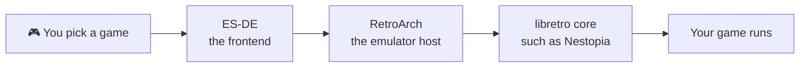

*The cabinet hums and does nothing, which is the saddest thing a game machine can do. Rewind Arcade holds the spell that wakes it: a set of plain text files that describe thirty-eight consoles, plus the tool that turns them into a working frontend. You will cast it, understand what it wrote, and boot your first game. That game will be one you are legally free to copy.*

## 🎯 Quest Objectives

By the end of this chapter you will:

- [ ] **Install the Rewind Arcade stack** using its `retropi` tool
- [ ] **Explain the frontend, emulator, and core** and how a launch flows through them
- [ ] **Add a legal homebrew game** and boot it in ES-DE
- [ ] **Read a system manifest** and tune an emulator without changing its code
- [ ] **Play the browser arcade** on the same machine

## 🗺️ Quest Prerequisites

- **[Chapter II](/quests/0011/twin-rigs-02-the-rewind-cabinet/)** — a healthy Pi running 64-bit Raspberry Pi OS with the desktop
- **A monitor or TV, keyboard, and mouse** on the Pi for this chapter, because ES-DE needs a graphical session
- **A USB gamepad** — a keyboard works for the first test

> ⚖️ **The law of the arcade:** Rewind Arcade downloads emulators and cores, and it never downloads games or BIOS files. This chapter uses a GPL-licensed homebrew game. For commercial games, use only dumps of games you own, and check the law where you live.

## 🌍 Choose Your Adventure Platform

*Every spell in this chapter runs on the Pi. Open a terminal on its desktop, or connect from your fortress.*

### 🐧 Linux

```bash
ssh rig@rewind.local
sudo apt update && sudo apt install -y git
```

The last step of Chapter 3 needs the Pi's own screen, because a game window cannot open over a plain SSH session.

## 🧙‍♂️ Chapter 1: Summon the Stack

### ⚔️ Skills You'll Forge

- Reading a tool's report before letting it change anything
- Installing a layered software stack

Clone the repository and run its Pi bootstrap. It installs system packages and RetroArch, then prints advice for your board.

```bash
git clone https://github.com/bamr87/rewind-arcade.git
cd rewind-arcade
./emulate/platforms/raspberrypi/bootstrap.sh
```

Now ask the tool what it sees. `doctor` changes nothing, and it finishes with the exact commands to fix anything it found.

```bash
./bin/retropi doctor
```

When you are happy with its report, install the rest:

```bash
./bin/retropi install
```

That single command installs ES-DE, RetroArch, and the libretro cores for your enabled systems, then generates all the configuration. Allow time for the downloads.

### 🔍 Knowledge Check

- [ ] Which command is safe to run at any time, and why?
- [ ] What does `install` set up, in order?

## 🧙‍♂️ Chapter 2: Learn the Three Layers

### ⚔️ Skills You'll Forge

- Tracing a game launch through a frontend, an emulator, and a core
- Reading declarative configuration

Three separate layers work together each time you press A on a game:



| Layer | Its job | Where it lives |
|---|---|---|
| **ES-DE** | Shows your library and starts games | `~/ES-DE` |
| **RetroArch** | Provides video, audio, input, and saves | Installed by `retropi` |
| **Core** | Emulates one console | Downloaded per system |

Rewind Arcade never special-cases a console in its code. A system is a single YAML file, which you can read for yourself:

```bash
sed -n 1,30p emulate/config/systems/nes.yaml
./bin/retropi systems show nes
```

The last line of `systems show` is the exact command the frontend will run. When a game will not start, that line is the fastest place to look.

### 🔍 Knowledge Check

- [ ] Which layer would you change to try a different NES emulator?
- [ ] Where do you find the real launch command for a system?

## 🧙‍♂️ Chapter 3: Boot a Game You May Keep

### ⚔️ Skills You'll Forge

- Adding a game the tool can file correctly
- Proving emulation works before you add a library

[Nova the Squirrel](https://github.com/NovaSquirrel/NovaTheSquirrel) is a real NES game, released under the GPL by its author. That makes it a perfect first test.

```bash
curl -L -o ~/nova.nes https://github.com/NovaSquirrel/NovaTheSquirrel/releases/download/v1.0.6a/nova.nes
./bin/retropi roms add ~/nova.nes --system nes
./bin/retropi roms scan
./bin/retropi build
```

`build` regenerates everything that comes from the manifests. Run it after any configuration change. Now go to the Pi's own screen, open a terminal there, and launch the frontend:

```bash
cd ~/rewind-arcade
./bin/retropi frontend launch
```

Find **Nintendo Entertainment System**, pick Nova, and play. To leave a game, press Select and Start together on a gamepad.

If ES-DE complains about OpenGL, use the fix from the project's Pi guide:

```bash
MESA_GL_VERSION_OVERRIDE=3.3 ./bin/retropi frontend launch
```

### 🔍 Knowledge Check

- [ ] Why use `--system nes` instead of letting the tool guess?
- [ ] Why can't you launch ES-DE from a plain SSH session?

## 🧙‍♂️ Chapter 4: Tune the Spell

### ⚔️ Skills You'll Forge

- Overriding behavior through configuration, not code
- Trimming a frontend to fit its hardware

You can swap the emulator for any system without editing a manifest. Your choices land in `emulate/config/local.yaml`, which stays out of Git.

```bash
./bin/retropi config set emulators.nes mesen
./bin/retropi build
```

Mesen is more accurate than the default and heavier on a Pi. Play Nova for a few minutes, then decide. To go back:

```bash
./bin/retropi config set emulators.nes nestopia
```

Trim any system your board cannot run, so the menu only shows what works. On a Pi 5, Saturn is a good candidate:

```bash
./bin/retropi systems disable saturn
./bin/retropi build
```

Then visit the workspace's Play pillar. Rewind Arcade also ships original browser games that need no ROMs at all. Open Chromium on the Pi and go to the [live arcade](https://bamr87.github.io/rewind-arcade/). A connected gamepad drives it too.

If you already own a game collection, the Catalog pillar can tell you whether a dump is good:

```bash
./bin/cartidx init --systems nes,snes,n64
```

### 🔍 Knowledge Check

- [ ] Which file holds your local choices, and why should it stay out of Git?
- [ ] What happens if you skip `build` after changing a setting?

## 🎮 Implementation Challenge

**Objective:** Prove the whole chain works, then show that you understand it.

**Success Criteria:**

- [ ] `./bin/retropi doctor` shows no failures
- [ ] Nova boots from ES-DE and takes input
- [ ] You changed an emulator, tested it, and changed it back
- [ ] Your chronicle's `README.md` explains the three layers in your own words

On your fortress, in `twin-rigs`:

```bash
git add README.md
git commit -m "docs: explain the arcade's three layers"
```

## 🔍 Quest Network


## 🎁 Rewards & Progression

- 🎮 **Arcade Waker** — brought a full emulation stack to life from source
- ⚡ **Skills unlocked:** layered software diagnosis, declarative configuration, legal game handling
- 🏆 **80 XP** toward the campaign

*Chapters sit at different levels by design: the campaign uses the level number for progression, and each chapter also appears on its own level hub.*

## 🔁 Reproduce It

The reference build for this chapter is the public repository itself:

- [`emulate/docs/raspberry-pi.md`](https://github.com/bamr87/rewind-arcade/blob/main/emulate/docs/raspberry-pi.md) — board tuning and setup
- [`emulate/docs/commands.md`](https://github.com/bamr87/rewind-arcade/blob/main/emulate/docs/commands.md) — every `retropi` command
- [`docs/legal.md`](https://github.com/bamr87/rewind-arcade/blob/main/docs/legal.md) — what the project will and will not download

## 🔮 Next Adventures

It runs, but it still needs a keyboard and a patient owner. Next you turn it into a console.

- ➡️ **Next chapter:** [Chapter IV — The Caravan Road](/quests/0101/twin-rigs-04-the-caravan-road/)
- ⬅️ **Previous chapter:** [Chapter II — The Rewind Cabinet](/quests/0011/twin-rigs-02-the-rewind-cabinet/)
- 👑 **Campaign hub:** [Epic Quest: The Twin Rigs](/quests/codex/twin-rigs/)

## 📚 Resource Codex

- [Rewind Arcade](https://github.com/bamr87/rewind-arcade) — the workspace, its docs, and its issue tracker
- [ES-DE](https://es-de.org/) — the frontend's official site
- [RetroArch documentation](https://docs.libretro.com/) — cores, settings, and input
- [Nova the Squirrel](https://github.com/NovaSquirrel/NovaTheSquirrel) — the homebrew game used in this chapter

## 🕸️ Knowledge Graph

*Structured wiki-links connect this quest to the IT-Journey knowledge graph. Open the [Obsidian Graph View](/notes/obsidian/graph/) to explore connections.*

**Campaign hub:** [[Epic Quest: The Twin Rigs]] **Level hub:** [[Level 0100 - Frontend Development & Docker]] **Previous:** [[The Rewind Cabinet: Raise a Healthy Raspberry Pi]] **Next:** [[The Caravan Road: Turn the Pi into a Console]] **Obsidian docs:** [[Obsidian Knowledge Graph and Wiki Links]]
