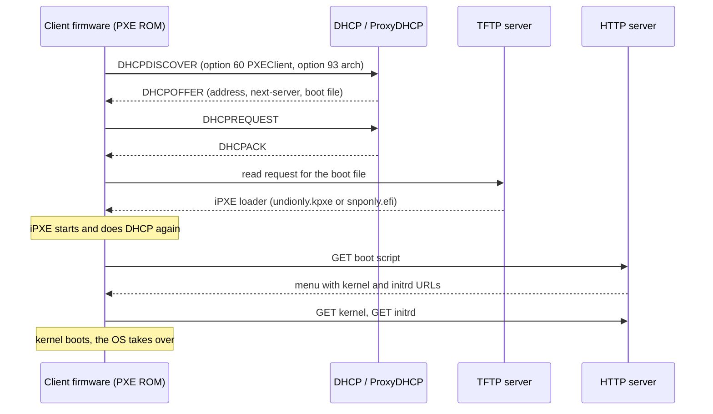
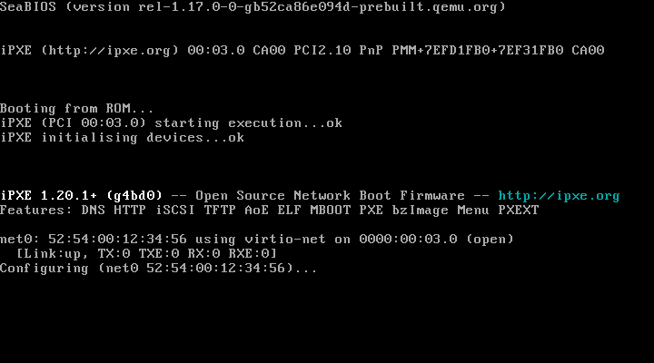
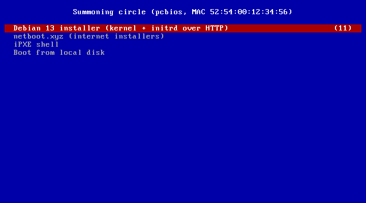
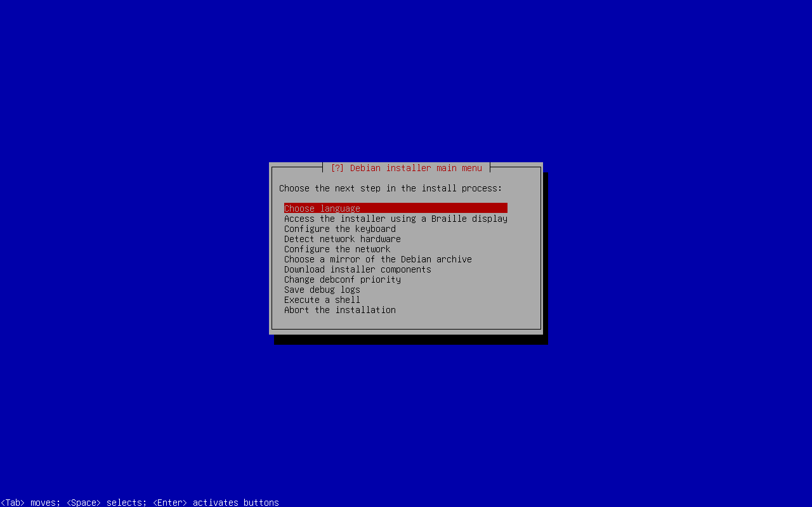
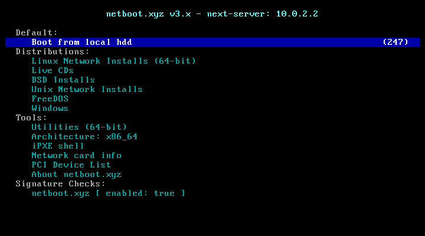
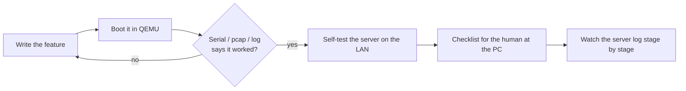

*Every machine you have ever installed began the same way: someone carried the operating system to it on a disc or a stick. This quest teaches the older and stranger magic - a machine with an empty disk, no stick and no disc, that asks the network who it should become, and receives an answer.*

*You will learn the ritual the firmware speaks (PXE), the messengers it calls (DHCP, TFTP and HTTP), and the familiar that makes it bearable (iPXE). Then you will build a boot server in a QEMU laboratory, summon a Debian installer onto a virtual machine in both BIOS and UEFI mode, and finally carry the circle onto a real network - where, as you will see, the wire has opinions of its own.*

## 📖 The Legend Behind This Quest

This quest grew out of a real project, **one-usb**: a multiboot USB stick built entirely from code and tested in QEMU before it ever touches hardware. It was built over a long pair-programming session with Claude Code, and network boot appeared in it twice:

1. **As a client.** The stick's boot menu carries **netboot.xyz**, an iPXE program that downloads a menu of dozens of operating-system installers from the internet. A few megabytes on the stick stand in for gigabytes of ISOs.
2. **As a server.** Later, the goal changed: boot a PC that has *no stick at all* and an empty M.2 drive, and install an operating system onto it over the LAN. That needed a boot server - ProxyDHCP, TFTP and HTTP - written from scratch in about 500 lines of Python, verified in a QEMU VM, and then taken onto a real network with a real test PC.

Every lesson in this quest is something that project ran into: a firmware quirk that changed the design, a loop that had to be broken, a network that swallowed the answers. Where we quote one-usb, the code is real; where something is not yet proven on hardware, this quest says so.

## 🧪 About the Screenshots in This Quest

Every screen below is a **real capture** from running this quest's lab on an Apple Silicon Mac with Homebrew QEMU 10 (x86 emulated with TCG). The captures came from QEMU's monitor `screendump` command while the VM booted from the lab server. The BIOS path reached the Debian installer in about 25 seconds; the UEFI path took about 95 seconds under emulation.

## 🎯 Quest Objectives

By the time you complete this journey, you will have mastered:

### Primary Objectives (Required for Quest Completion)
- [ ] **The Boot Chain** - Explain what the firmware, DHCP, TFTP, HTTP and iPXE each do during a network boot
- [ ] **The Messengers** - Read the DHCP options a PXE client sends and choose the boot file it needs
- [ ] **The Familiar** - Write iPXE scripts with a menu, a kernel and an initrd, and chain-load iPXE safely
- [ ] **The BIOS Circle** - Boot the Debian installer in a BIOS VM from your own TFTP and HTTP server
- [ ] **The UEFI Circle** - Boot the same installer in a UEFI VM through UEFI HTTP Boot
- [ ] **The Field Trial** - Plan a real-LAN deployment with ProxyDHCP and diagnose why a client does not boot

### Secondary Objectives (Bonus Achievements)
- [ ] **Prove It With Packets** - Capture the VM's traffic and assert on DNS queries and TCP connections
- [ ] **Per-Machine Menus** - Give each client a menu keyed by its MAC address
- [ ] **Live in RAM** - Boot a full live system whose root filesystem streams over HTTP

### Mastery Indicators
You'll know you've truly mastered this quest when you can:
- [ ] Draw the boot sequence from memory, naming the port each step uses
- [ ] Look at a server log and say which step a failing client reached
- [ ] Explain why your boot server must stay silent for ordinary DHCP clients
- [ ] Pick the right iPXE loader for a client from its architecture code

## 🗺️ Quest Prerequisites

### 📋 Knowledge Requirements
- [ ] Completion of [Linux Fundamentals](/quests/0000/linux-fundamentals/) and [Bash Scripting](/quests/0010/bash-scripting/)
- [ ] Basic IP networking: addresses, subnets, the router as the default gateway
- [ ] Recommended: [Forge Your Own Dev Server](/quests/1000/forge-your-own-dev-server/), which gives you a Linux box that makes an excellent permanent boot server

### 🛠️ System Requirements
- [ ] QEMU with x86-64 system emulation
- [ ] UEFI firmware for QEMU (OVMF / edk2) - QEMU's packages usually include it
- [ ] Python 3 and `curl`
- [ ] For the field trial only: a spare PC with **wired** Ethernet, and permission to run a boot service on that network

### 🧠 Skill Level Indicators
- [ ] You are willing to read hexadecimal option codes without flinching
- [ ] You prefer a log line over a guess

## 🌍 Choose Your Adventure Platform

The lab runs anywhere QEMU runs. The commands differ only in how you install QEMU and where its UEFI firmware lives.

### 🍎 macOS Kingdom Path
```bash
brew install qemu python
# UEFI firmware ships with Homebrew's QEMU:
export OVMF_CODE="$(brew --prefix)/share/qemu/edk2-x86_64-code.fd"
export OVMF_VARS_TEMPLATE="$(brew --prefix)/share/qemu/edk2-i386-vars.fd"
ls -l "$OVMF_CODE" "$OVMF_VARS_TEMPLATE"
```

### 🪟 Windows Empire Path
```powershell
# Use WSL2 with Ubuntu or Debian, then follow the Linux path inside it.
wsl --install -d Debian
wsl -d Debian
```

### 🐧 Linux Territory Path
```bash
sudo apt install qemu-system-x86 ovmf python3 curl     # Debian / Ubuntu
export OVMF_CODE=/usr/share/OVMF/OVMF_CODE_4M.fd
export OVMF_VARS_TEMPLATE=/usr/share/OVMF/OVMF_VARS_4M.fd
ls -l "$OVMF_CODE" "$OVMF_VARS_TEMPLATE"
```

On Linux with KVM, add `-accel kvm` to the QEMU commands below and everything runs at native speed.

## 🧙‍♂️ Chapter 1: The Boot Chain - What Happens Before the Kernel

### ⚔️ Skills You'll Forge in This Chapter
- Naming every hop between power-on and a running kernel
- Understanding why a network boot needs three different services

**PXE** (Preboot eXecution Environment) is a standard, built into the firmware of almost every wired network card, for loading a program over the network before any operating system exists. The firmware cannot do much on its own: it can get an address, download one small file, and run it. That small file is the **NBP** (network bootstrap program). Everything after that - menus, kernels, installers - is the NBP's job.

A classic PXE boot needs three services:

| Service | Port | Job |
|---|---|---|
| **DHCP** | UDP 67 (server), 68 (client) | Give the client an IP address *and* tell it where its boot file is |
| **TFTP** | UDP 69 | Hand over the small NBP - the only protocol old PXE firmware can download with |
| **HTTP** | TCP 80 or any port | Serve everything big (kernels, initrds, root filesystems) once a smarter program is running |



### Three flavours of firmware

| Firmware | How it network-boots | What it can load |
|---|---|---|
| **Legacy BIOS** | PXE ROM on the NIC; TFTP only | A 16-bit NBP such as `undionly.kpxe` |
| **UEFI PXE** | The firmware's own network stack; TFTP only | An EFI program such as `snponly.efi` or `ipxe.efi` |
| **UEFI HTTP Boot** | The firmware's own stack; HTTP, no TFTP | An EFI program fetched from a URL |

UEFI HTTP Boot is the modern shortcut: no TFTP at all, and on many PCs you can **type the URL into the firmware setup**, which removes the DHCP part of the problem entirely. You will use that in Chapter 5 and Chapter 7.

### 🔍 Knowledge Check: The Boot Chain
- [ ] Why can't the firmware download a 1 GB root filesystem itself?
- [ ] Which of the three services could you remove on a UEFI HTTP Boot client?

## 🧙‍♂️ Chapter 2: The Messengers - DHCP Options That Matter

### ⚔️ Skills You'll Forge in This Chapter
- Reading the DHCP options a network-booting client sends
- Understanding full DHCP, ProxyDHCP and DHCP relay

A booting client announces itself in its DHCP packets. A boot server reads a handful of options and ignores everything else:

| Option | Name | Sent by | What it tells you |
|---|---|---|---|
| 60 | Vendor class | client | `PXEClient:Arch:00007:...` for PXE, `HTTPClient:...` for UEFI HTTP Boot |
| 93 | Client architecture | client | Which kind of program the client can run (table below) |
| 77 | User class | client | `iPXE` once iPXE itself is asking |
| 175 | iPXE encapsulated options | client | Present only when iPXE is asking |
| 66 / `siaddr` | Server name / next-server | server | Where to fetch the boot file |
| 67 / `file` | Boot file name | server | What to fetch: a TFTP file name or an HTTP URL |
| 43 | Vendor options | server | PXE settings; `PXE_DISCOVERY_CONTROL = 8` means "just use the boot file" |

Option 93 picks the loader. This is the table one-usb's server uses:

| Arch code | Client | Loader to send |
|---|---|---|
| 0 | x86 legacy BIOS | `undionly.kpxe` (uses the NIC ROM's own UNDI driver) |
| 6 | 32-bit UEFI | `ipxe.efi` |
| 7, 9 | x86-64 UEFI | `snponly.efi` (uses the firmware's own network driver) |
| 16 | x86-64 UEFI HTTP Boot | a URL to `snponly.efi` |

`snponly.efi` is the most compatible choice for UEFI: it drives the network card through the firmware's own driver instead of bringing its own, so it works on any NIC the firmware can use.

### Who answers: DHCP, ProxyDHCP or relay?

| Approach | When to use it | Cost |
|---|---|---|
| **Full DHCP** | You own the network and can replace or configure its DHCP server | You must hand out addresses correctly, or you break the LAN |
| **ProxyDHCP** | The router keeps handing out addresses; you only add boot information | A second server answering on the same broadcast domain |
| **DHCP relay** (`ip helper-address`) | Clients are on another subnet | Router configuration |

**ProxyDHCP** is the polite option and the one one-usb chose: the router still owns addresses, and the boot server answers **only** clients whose option 60 says `PXEClient` or `HTTPClient` (or whose option 77 says `iPXE`). An ordinary laptop asking for an address hears nothing from it. PXE clients also send a follow-up request to the boot server on **UDP 4011**, which the server answers directly.

### 🔍 Knowledge Check: The Messengers
- [ ] A client sends option 93 with value 0. Which loader do you send it?
- [ ] Why must a ProxyDHCP server never answer a DHCPDISCOVER without option 60?

## 🧙‍♂️ Chapter 3: The Familiar - iPXE and the Chain-Loading Loop

### ⚔️ Skills You'll Forge in This Chapter
- Writing iPXE scripts: menus, kernels, initrds and fallbacks
- Breaking the chain-loading loop

PXE firmware is limited: TFTP only, no scripting, no HTTP on older ROMs. So the standard trick is to use PXE just once, to download **iPXE**, an open-source network boot program that speaks HTTP (and on most builds HTTPS), DNS, iSCSI and a small scripting language. This is **chain-loading**.

An iPXE script looks like this:

```bash
#!ipxe
set srv http://10.0.2.2:8780

:menu
menu Summoning circle (${platform}, MAC ${net0/mac})
item debian      Debian 13 installer (kernel + initrd over HTTP)
item shell       iPXE shell
choose --default debian --timeout 15000 target || goto menu
goto ${target}

:debian
kernel ${srv}/debian/linux console=ttyS0,115200 initrd=initrd.gz || goto failed
initrd ${srv}/debian/initrd.gz || goto failed
boot || goto failed

:shell
shell
goto menu

:failed
echo Summoning failed - back to the menu in 10 s
sleep 10
goto menu
```

Useful built-in variables: `${platform}` is `efi` or `pcbios`, `${net0/mac}` is the client's MAC address, and `${net0/mac:hexhyp}` is the same with hyphens, safe to put in a URL. one-usb's server uses that last one to send each machine its own menu.

### ⚠️ The chain-loading loop

Here is the trap every PXE builder falls into once. The firmware asks DHCP for a boot file, you answer `snponly.efi`, iPXE starts - and **iPXE does its own DHCP**. If you answer it the same way, it downloads `snponly.efi` again, which does DHCP again, forever.

The fix is to answer iPXE differently from the firmware. There are three ways, and one-usb uses all of them:

1. **In DHCP:** if the request carries option 77 `iPXE` (or option 175), send the URL of a script instead of a loader.
2. **In HTTP:** if one URL is handed to everybody (QEMU's built-in DHCP does this), look at the `User-Agent` header. UEFI firmware says `UefiHttpBoot/1.0`; iPXE says `iPXE/2.0.0`. Give the firmware the loader and give iPXE the script.
3. **`autoexec.ipxe`:** iPXE looks for a file with that name next to where it was loaded from before it does DHCP. Serve one that chains to your menu, and the loop never starts.

This is the core of one-usb's `boot_choice()` - the whole decision fits in a dozen lines:

```python
def boot_choice(pkt: dict, http_base: str) -> tuple[str, str] | None:
    """(client class, boot file) for a PXE/iPXE/HTTP-boot client, else None."""
    vendor = pkt["opts"].get(60, b"")
    user_class = pkt["opts"].get(77, b"")
    arch = struct.unpack("!H", pkt["opts"][93][:2])[0] if len(pkt["opts"].get(93, b"")) >= 2 else 0
    if b"iPXE" in user_class or 175 in pkt["opts"]:
        return "iPXE", f"{http_base}/boot.ipxe"          # iPXE is asking: send the script
    if vendor.startswith(b"HTTPClient"):
        return "HTTPClient", f"{http_base}/uefi/boot.efi" # UEFI HTTP Boot: send a URL
    if vendor.startswith(b"PXEClient"):
        loader = ARCH_LOADER.get(arch)                    # PXE firmware: send a loader for its arch
        return ("PXEClient", loader) if loader else None
    return None                                           # not network-booting: stay silent
```

### 🔍 Knowledge Check: The Familiar
- [ ] What would you see in a server log if a client were stuck in the chain-loading loop?
- [ ] Why does one-usb send `undionly.kpxe` to BIOS clients instead of a full iPXE with its own drivers?

## 🧙‍♂️ Chapter 4: The BIOS Circle - A Boot Lab in QEMU

### ⚔️ Skills You'll Forge in This Chapter
- Building a complete boot server from one directory and one small Python script
- Using QEMU's built-in DHCP and TFTP so the lab needs no network setup at all

QEMU's user-mode network (`-netdev user`) contains a tiny DHCP server and a TFTP server. Inside the VM, your Mac or Linux host is always reachable at `10.0.2.2`. That makes a perfect laboratory: no router, no root, no risk to your real network.

### Step 1: Gather the reagents

```bash
mkdir -p ~/pxe-lab/debian && cd ~/pxe-lab
D=https://deb.debian.org/debian/dists/trixie/main/installer-amd64/current/images/netboot/debian-installer/amd64
curl -fLo debian/linux     "$D/linux"        # the installer's kernel (about 12 MB)
curl -fLo debian/initrd.gz "$D/initrd.gz"    # the installer itself (about 41 MB)
curl -fLO https://boot.ipxe.org/x86_64-efi/snponly.efi   # iPXE for UEFI clients
ls -lh debian snponly.efi
```

### Step 2: Write the scripts

`boot.ipxe` is the first thing iPXE runs. Its only job is to move from TFTP to HTTP:

```bash
cat > boot.ipxe <<'EOF'
#!ipxe
# Handed to iPXE first. Everything after this line travels over HTTP, not TFTP.
chain http://10.0.2.2:8780/menu.ipxe
EOF
```

`menu.ipxe` is the menu from Chapter 3, plus a netboot.xyz entry and a way back to the local disk:

```bash
cat > menu.ipxe <<'EOF'
#!ipxe
set srv http://10.0.2.2:8780

:menu
menu Summoning circle (${platform}, MAC ${net0/mac})
item debian      Debian 13 installer (kernel + initrd over HTTP)
item netbootxyz  netboot.xyz (internet installers)
item shell       iPXE shell
item local       Boot from local disk
choose --default debian --timeout 15000 target || goto menu
goto ${target}

:debian
kernel ${srv}/debian/linux console=ttyS0,115200 priority=low initrd=initrd.gz || goto failed
initrd ${srv}/debian/initrd.gz || goto failed
boot || goto failed

:netbootxyz
# Plain HTTP: the iPXE ROM inside QEMU (and many NICs) is built without HTTPS.
iseq ${platform} efi && chain --autofree http://boot.netboot.xyz/ipxe/netboot.xyz.efi ||
iseq ${platform} pcbios && chain --autofree http://boot.netboot.xyz/ipxe/netboot.xyz.lkrn ||
goto failed

:shell
shell
goto menu

:local
exit

:failed
echo Summoning failed - back to the menu in 10 s
sleep 10
goto menu
EOF
```

`server.py` serves the directory, with one special URL for Chapter 5 that answers firmware and iPXE differently:

```python
#!/usr/bin/env python3
"""A tiny boot server: static files, plus one URL that answers firmware and iPXE differently."""
import http.server
import os
from pathlib import Path

ROOT = Path(__file__).resolve().parent


class Handler(http.server.SimpleHTTPRequestHandler):
    def __init__(self, *args, **kwargs):
        super().__init__(*args, directory=str(ROOT), **kwargs)

    def route(self):
        if self.path == "/boot.efi":
            agent = self.headers.get("User-Agent", "")
            if "iPXE" in agent:          # iPXE came back for the same URL: give it the script
                self.path = "/boot.ipxe"
            else:                        # UEFI firmware: give it iPXE itself
                self.path = "/snponly.efi"
            self.log_message("boot.efi -> %s (User-Agent: %s)", self.path, agent or "none")

    def do_HEAD(self):        # UEFI HTTP Boot asks for the size first
        self.route()
        return super().do_HEAD()

    def do_GET(self):
        self.route()
        return super().do_GET()


if __name__ == "__main__":
    port = int(os.environ.get("PORT", "8780"))
    print(f"serving {ROOT} on :{port}")
    http.server.ThreadingHTTPServer(("0.0.0.0", port), Handler).serve_forever()
```

Save it as `~/pxe-lab/server.py`, start it in its own terminal, and check both personalities of `/boot.efi`:

```bash
cd ~/pxe-lab && python3 server.py
# in a second terminal:
curl -s -o /dev/null -w '%{http_code} %{size_download} bytes\n' http://localhost:8780/boot.efi   # firmware: the EFI program
curl -s -A 'iPXE/2.0.0' http://localhost:8780/boot.efi                                         # iPXE: the script
```

> **Port already taken?** Docker Desktop and other dev servers like to hold common ports - on the machine these captures came from, 8000 already belonged to Docker. Pick a free port, export `PORT`, and change `8780` in `boot.ipxe` and `menu.ipxe` to match.

### Step 3: Boot a BIOS machine from the wire

```bash
cd ~/pxe-lab
qemu-system-x86_64 -m 2048 -serial stdio \
  -netdev user,id=n0,tftp="$PWD",bootfile=boot.ipxe \
  -device virtio-net-pci,netdev=n0 \
  -boot n
```

`tftp=` points QEMU's TFTP server at your lab directory and `bootfile=` is what its DHCP server puts in option 67. QEMU's network cards carry **iPXE as their option ROM**, so in BIOS mode iPXE is already running when it reads `boot.ipxe` - no chain-loading needed.



Read that banner closely: **`Features: DNS HTTP iSCSI TFTP ...` - no HTTPS.** The first draft of this lab's menu loaded netboot.xyz from an `https://` URL, which this ROM cannot fetch. That is why the menu above uses plain HTTP for netboot.xyz. Real NIC ROMs vary the same way; check the banner before you trust HTTPS.

A few seconds later, your menu appears, counting down to its default:



When the countdown ends, iPXE fetches the kernel and initrd from your server, and the Debian installer starts:



Your server's log tells the same story from the other side:

```text
"GET /menu.ipxe HTTP/1.1" 200 -
"GET /debian/linux HTTP/1.1" 200 -
"GET /debian/initrd.gz HTTP/1.1" 200 -
```

Choose the netboot.xyz entry instead and the same chain lands in netboot.xyz's own menu, downloaded live from the internet:



Note its default: **Boot from local hdd**, after a countdown. Wait too long and it boots the empty disk instead. one-usb's user guide warns about exactly this.

### 🔍 Knowledge Check: The BIOS Circle
- [ ] Which process answered the VM's DHCP request, and which served `boot.ipxe`?
- [ ] Why did this lab not need `undionly.kpxe` at all?

## 🧙‍♂️ Chapter 5: The UEFI Circle - HTTP Boot in QEMU

### ⚔️ Skills You'll Forge in This Chapter
- Driving UEFI HTTP Boot with nothing but a URL in option 67
- Watching the chain-loading loop get broken by the `User-Agent` header

UEFI firmware does not use QEMU's iPXE ROM; it uses its own network stack, which needs an EFI program. Point option 67 at the special URL and let the firmware fetch it over HTTP:

```bash
cd ~/pxe-lab
cp "$OVMF_VARS_TEMPLATE" uefi-vars.fd          # the firmware's writable settings, one per VM
qemu-system-x86_64 -machine q35 -cpu max -m 2048 -serial stdio \
  -drive if=pflash,format=raw,readonly=on,file="$OVMF_CODE" \
  -drive if=pflash,format=raw,file=uefi-vars.fd \
  -netdev user,id=n0,bootfile=http://10.0.2.2:8780/boot.efi \
  -device virtio-net-pci,netdev=n0,bootindex=0
```

> **⚠️ Two traps found while writing this chapter.** Without `-cpu max`, this firmware showed **no network boot entries at all** and dropped straight into the EFI shell. And the first version of `server.py` overrode only `do_GET`, so the firmware's `HEAD /boot.efi` got a 404 - after which the download went through but iPXE never called back. Answering `HEAD` exactly like `GET` fixed it.

On the serial console you can watch the firmware try its boot options in order. PXE over IPv4 receives the URL as a TFTP file name and fails; IPv6 gets no offer; then HTTP Boot succeeds:

```text
>>Start PXE over IPv4.
  NBP filename is http://10.0.2.2:8780/boot.efi
  PXE-E23: Client received TFTP error from server.
>>Start PXE over IPv6.
  PXE-E16: No valid offer received.
>>Start HTTP Boot over IPv4....
  URI: http://10.0.2.2:8780/boot.efi
```

And the server log shows the whole chain, including the loop being broken:

```text
"HEAD /boot.efi HTTP/1.1" 200 -
boot.efi -> /snponly.efi (User-Agent: UefiHttpBoot/1.0)
"GET /boot.efi HTTP/1.1" 200 -
"GET /autoexec.ipxe HTTP/1.1" 404 -
boot.efi -> /boot.ipxe (User-Agent: iPXE/2.0.0+ (gc49fb))
"GET /boot.efi HTTP/1.1" 200 -
"GET /menu.ipxe HTTP/1.1" 200 -
"GET /debian/linux HTTP/1.1" 200 -
"GET /debian/initrd.gz HTTP/1.1" 200 -
```

Read it line by line: the firmware asks for the size and then the file, and gets iPXE. iPXE first looks for `autoexec.ipxe` next to itself (the third escape from the loop, unused here), then does DHCP, receives the **same URL**, and asks for it again - but this time its `User-Agent` says `iPXE`, so it gets the script. From there it is the same menu as the BIOS circle.

### 🔍 Knowledge Check: The UEFI Circle
- [ ] What would the log look like if `server.py` ignored the `User-Agent`?
- [ ] How could you make the `autoexec.ipxe` request succeed, and would you still need the `User-Agent` branch?

## 🧙‍♂️ Chapter 6: Beyond the Installer - Live Systems, Per-Machine Menus, Progress

### ⚔️ Skills You'll Forge in This Chapter
- Booting a full live system into RAM over HTTP
- Making the boot server remember machines

An installer is small. one-usb went further and network-booted its whole **home base** - a Debian live desktop - with no disk at all. Debian's `live-boot` can download its root filesystem over HTTP with the `fetch=` kernel parameter, so the menu entry is just a longer command line:

```bash
set live boot=live components fetch=${srv}/live/filesystem.squashfs username=user console=ttyS0,115200
kernel ${srv}/live/vmlinuz ${live} initrd=initrd.img || goto failed
initrd ${srv}/live/initrd.img || goto failed
boot || goto failed
```

In one-usb's VM test this pulled a 12 MB kernel, a 113 MB initrd (at 57 MB/s) and the 1.1 GB root filesystem (at 47 MB/s) into RAM, and the live system reported ready about three minutes after power-on. The cost: the client needs enough RAM to hold the whole root filesystem, so one-usb's VM used 8 GB.

Two more ideas from one-usb's server worth stealing:

- **Per-machine menus.** The first script chains to `menu.ipxe?mac=${net0/mac:hexhyp}`, so the server knows who is asking. After a machine reports that its install finished, its menu defaults to **Boot from local disk** - otherwise a PC set to boot from the network first would reinstall itself every morning.
- **Progress reports.** The installer calls back `GET /report?stage=...&pct=...&mac=...`, so the operator watches each machine move through download, write and verify in one log.

### 🔍 Knowledge Check: Beyond the Installer
- [ ] Why does `fetch=` need more RAM than an installer does?
- [ ] What would happen without the "default to local disk after install" rule?

## 🧙‍♂️ Chapter 7: The Field Trial - Taking the Circle Onto a Real LAN

### ⚔️ Skills You'll Forge in This Chapter
- Running ProxyDHCP and TFTP next to an existing router
- Diagnosing a client that does not boot, from the server's point of view

> **⚠️ Only on networks you own or administer.** A boot server answers broadcast traffic from every machine on the segment. On a shared or corporate network, ask first.

### The standard tool: dnsmasq in proxy mode

On a Linux boot server, **dnsmasq** provides ProxyDHCP and TFTP in one daemon. This configuration was written from the dnsmasq manual and was not part of this quest's captured runs - verify it with `log-dhcp` before you rely on it. Replace `eth0`, the subnet and the server address with yours:

```bash
sudo apt install dnsmasq
sudo mkdir -p /srv/pxe/tftp
sudo curl -fLo /srv/pxe/tftp/undionly.kpxe https://boot.ipxe.org/undionly.kpxe
sudo curl -fLo /srv/pxe/tftp/snponly.efi  https://boot.ipxe.org/x86_64-efi/snponly.efi
# PXE adds the ".0" layer suffix to pxe-service basenames itself, so provide those names too:
sudo ln -sf undionly.kpxe /srv/pxe/tftp/undionly.0
sudo ln -sf snponly.efi  /srv/pxe/tftp/snponly.0

sudo tee /etc/dnsmasq.d/pxe.conf >/dev/null <<'EOF'
port=0                                  # no DNS service, only DHCP and TFTP
interface=eth0
dhcp-range=192.168.1.0,proxy            # ProxyDHCP: the router keeps handing out addresses
log-dhcp                                # print every option a client sends
enable-tftp
tftp-root=/srv/pxe/tftp
dhcp-userclass=set:ipxe,iPXE            # iPXE is asking: tag it
pxe-service=tag:!ipxe,x86PC,"Network boot (BIOS)",undionly
pxe-service=tag:!ipxe,x86-64_EFI,"Network boot (UEFI)",snponly
pxe-service=tag:ipxe,x86PC,"Menu",http://192.168.1.10:8780/boot.ipxe
pxe-service=tag:ipxe,x86-64_EFI,"Menu",http://192.168.1.10:8780/boot.ipxe
EOF
sudo systemctl restart dnsmasq && journalctl -u dnsmasq -f
```

Then run `server.py` from Chapter 4 on the same machine, with `boot.ipxe` and `menu.ipxe` pointing at the server's LAN address instead of `10.0.2.2`.

### one-usb's way: ProxyDHCP in pure Python

one-usb needed a server that runs as a normal user on a Mac, so it implemented ProxyDHCP and TFTP itself. Three details in it are worth knowing whatever tool you use:

```python
# 1. Answer to the limited broadcast, from the right interface. Clients without an address
#    often ignore subnet-directed broadcasts (192.168.86.255), so send to 255.255.255.255 -
#    and pin the socket to the LAN interface so the reply leaves on the wire you meant.
if sys.platform == "darwin":
    s.setsockopt(socket.IPPROTO_IP, 25, socket.if_nametoindex(iface))   # IP_BOUND_IF
elif hasattr(socket, "SO_BINDTODEVICE"):
    s.setsockopt(socket.SOL_SOCKET, socket.SO_BINDTODEVICE, iface.encode())

# 2. Tell PXE firmware to skip boot-server discovery and just fetch the file (option 43).
if klass == "PXEClient":
    opts.append((43, b"\x06\x01\x08\xff"))  # PXE_DISCOVERY_CONTROL = 8

# 3. Never answer a client that is not network-booting - but do note that you heard it.
event("seen", pkt["mac"], "DHCP broadcast heard (not answered)")
```

That third line turns out to be the most valuable diagnostic in the whole server: it proves whether DHCP broadcasts from the rest of the LAN reach the boot server at all. Its TFTP side also negotiates `blksize` (capped at 1456 bytes so a block fits a 1500-byte Ethernet frame) and `tsize`, because modern firmware asks for both.

Before inviting a real machine, one-usb **self-tested** the running server from the same Mac with hand-built packets - a unicast PXE request to port 4011 - and checked TFTP and HTTP byte for byte. Here is a standalone version of that probe. It sends one DHCPREQUEST as a UEFI x64 PXE client would and prints what the boot server answers:

```python
#!/usr/bin/env python3
"""pxe-probe.py SERVER_IP - ask a ProxyDHCP server on udp/4011 what it would boot."""
import socket
import struct
import sys

mac = bytes.fromhex("020000c0ffee")                    # a locally administered test MAC
vendor = b"PXEClient:Arch:00007:UNDI:003016"
opts = bytes([53, 1, 3])                               # DHCPREQUEST
opts += bytes([60, len(vendor)]) + vendor              # "I am a PXE client"
opts += bytes([93, 2, 0, 7]) + b"\xff"                 # architecture 7: x86-64 UEFI
pkt = (struct.pack("!BBBB", 1, 1, 6, 0) + b"\x13\x37\xbe\xef" + b"\0" * 20
       + mac + b"\0" * 10 + b"\0" * 192 + b"\x63\x82\x53\x63" + opts)

s = socket.socket(socket.AF_INET, socket.SOCK_DGRAM)
s.settimeout(3)
s.sendto(pkt, (sys.argv[1], 4011))
data, _ = s.recvfrom(2048)
replies, i = {}, 240
while i < len(data) and data[i] != 255:
    if data[i] == 0:
        i += 1
        continue
    replies[data[i]] = data[i + 2: i + 2 + data[i + 1]]
    i += 2 + data[i + 1]
print("next-server:", socket.inet_ntoa(data[20:24]))
print("boot file:  ", replies.get(67, b"").decode())
```

### The field trial log - a case still open

Here is what happened when one-usb's server met a real PC, wired into an access point on a home Wi-Fi network, with the boot server on a Mac connected over Wi-Fi. This is the live server log, shortened:

```text
server 192.168.86.20   PXE on en0 (192.168.86.20, broadcast 192.168.86.255)
seen   08:9e:08:e9:63:bc  DHCP broadcast heard (not answered)
dhcp   a8:a1:59:0c:6a:0a  HTTPClient DISCOVER, arch 16 (udp/67 from 0.0.0.0)
dhcp   a8:a1:59:0c:6a:0a  HTTPClient offer -> http://192.168.86.20:8780/uefi/boot.efi
dhcp   a8:a1:59:0c:6a:0a  HTTPClient REQUEST, arch 16, wants 192.168.86.235, server 192.168.86.1
dhcp   a8:a1:59:0c:6a:0a  PXEClient DISCOVER, arch 7 (udp/67 from 0.0.0.0)
dhcp   a8:a1:59:0c:6a:0a  PXEClient offer -> snponly.efi
dhcp   a8:a1:59:0c:6a:0a  PXEClient REQUEST, arch 7, wants 192.168.86.235, server 192.168.86.1
```

Read it as a detective would:

- **The client's broadcasts reach the server.** Both its HTTP Boot (arch 16) and PXE (arch 7) attempts are heard, so the access point does bridge broadcasts *toward* the Mac.
- **The server answers each one.** Offers go out for both personalities.
- **The client accepts the router's address** (`server 192.168.86.1`) - correct, that is how ProxyDHCP is meant to work.
- **The client never comes back.** No TFTP read, no `HTTP GET`. And when the firmware was given the boot URL typed in by hand, no request arrived either.

When even a typed URL produces no HTTP request, the problem is not DHCP any more: **unicast traffic from the wired client to the Wi-Fi client is not getting through.** Many access points, mesh nodes and extenders isolate clients from each other or filter traffic between the wired and wireless sides. At the time of writing this case is still open; the next steps are the ones any network engineer would take:

1. Run the boot server on the **same wire** as the client - an Ethernet adapter on the server, plugged into the same switch.
2. Or connect the server **directly** to the client with one cable and let the server be the DHCP server for that two-machine network (on macOS, Internet Sharing does this).
3. Check the access point for "client isolation" or "AP isolation" settings.

### 🔍 Knowledge Check: The Field Trial
- [ ] Why is "DHCP broadcast heard (not answered)" the first thing to check on a new network?
- [ ] The client receives offers but never requests a file. Name three possible causes.

## 🧙‍♂️ Chapter 8: The Bestiary - Field Guide to Network Boot Failures

| Symptom | Likely cause | Remedy |
|---|---|---|
| No network boot entry in the boot menu | Network stack or PXE disabled in firmware setup | Enable "Network Stack", "PXE" and "HTTP Boot" |
| QEMU UEFI VM goes straight to the EFI shell | Firmware offered no network entries with the default CPU model | Add `-cpu max` (found while writing this quest) |
| `PXE-E16: No valid offer received` | No DHCP answer with boot information reaches the client | Is the boot server on the same segment? Check a relay or the "seen" log |
| `PXE-E23: Client received TFTP error from server` | Wrong file name, or a URL given to a TFTP-only client | Match the boot file to the client class (option 60) |
| Client downloads iPXE again and again | Chain-loading loop | Answer iPXE (option 77 / `User-Agent`) with a script |
| UEFI HTTP Boot downloads iPXE but nothing follows | Server mishandles `HEAD` | Answer `HEAD` like `GET` |
| iPXE: HTTPS URL fails, HTTP works | iPXE build without HTTPS (QEMU's ROM, many NIC ROMs) | Use HTTP, or chain to an iPXE build that has HTTPS |
| `Could not boot` then "booting from local disk" | A menu countdown ran out (netboot.xyz defaults to the local disk) | Pick an entry before the timeout |
| Security violation / image not authorized | Secure Boot: iPXE and many loaders are not Microsoft-signed | Turn Secure Boot off for the trial, or use a signed shim chain |
| Nothing at all over Wi-Fi | PXE and HTTP Boot need a wired NIC | Use Ethernet; one-usb boots a Wi-Fi-capable live system instead |
| USB-Ethernet adapter not offered | Firmware has no driver for the adapter | Try another adapter or the built-in port |
| Server sees broadcasts, client never fetches | Client isolation on an access point or mesh | Same-wire server, or a direct cable |
| Installer HTTPS errors after boot | Client clock far off | Set the time in firmware setup |

### A story from the client side: netboot.xyz under Ventoy

one-usb's stick boots netboot.xyz through the **Ventoy** boot manager. In the very first spike, Ventoy refused `netboot.xyz.iso` in UEFI mode with "No bootfile found for UEFI": the ISO keeps its EFI loader only inside its El Torito boot image, which Ventoy cannot start. The fix changed the design: the stick carries `netboot.xyz.efi` for UEFI and `netboot.xyz.iso` for BIOS, and hides each one in the other firmware mode. The lesson generalizes: **a network boot program comes in per-firmware builds - ship the one each firmware can actually start.**

## 🧙‍♂️ Chapter 9: The Wards - Security of Network Boot

Classic PXE trusts the network completely. Whoever answers DHCP first decides what your machine runs. Keep these wards in place:

- **Answer only booting clients.** A boot server that answers every DHCPDISCOVER is a rogue DHCP server. ProxyDHCP that checks option 60 is not.
- **Serve read-only, from fixed directories.** one-usb's server validates every file name against `[\w.-]+` and resolves paths so `../` can never escape its directories.
- **Use HTTPS and signatures where you can.** iPXE builds with HTTPS can verify certificates, and netboot.xyz verifies signatures of what it downloads (its menu shows "Signature Checks: enabled").
- **Prefer Secure Boot in production.** Turning it off is fine for a lab and a trial; a fleet should use signed loaders (shim and signed GRUB, as distributions ship them).
- **Isolate the boot network.** In production, provisioning usually lives on its own VLAN.

## 🧙‍♂️ Chapter 10: The Apprentice and the Familiar - Building Boot Infrastructure With an AI Agent

one-usb was built with Claude Code doing most of the typing. Boot infrastructure is a hard place for an agent - its results appear on a screen nobody captured, on hardware it cannot touch - and the session found habits that make it work:

- **Make the VM the finish line.** Every feature had a test that boots QEMU and checks something objective: "the serial console printed `ONEUSB-READY`", "the packet capture contains a DNS query for `boot.netboot.xyz` and a TCP connection to it". The agent iterated until the test passed instead of declaring success.
- **Prefer the serial console to screenshots.** Under UEFI, screendumps of iPXE's text console came out blank while the firmware mirrored the same text to serial. OCR misread `netboot.xyz` as `netboot.xy2`, so the menu check matched the stable words "Network install" instead.
- **Capture packets without extra tools.** QEMU's `-object filter-dump,netdev=n0,file=vm.pcap` records the VM's traffic; a 100-line Python reader turns it into "which names were looked up, which addresses got a SYN".
- **Test the server before the hardware.** The unicast self-test (Chapter 7) proved DHCP, TFTP and HTTP answers on the real network before a human walked over to the test PC.
- **Hand the human the steps the agent cannot do.** The agent cannot press F12 or change firmware settings. It wrote a short checklist (Ethernet cable, Secure Boot off, network stack on, which boot entry, which URL to type) and then watched the server log, reporting each stage as the machine reached it.
- **Be honest about what is not proven.** The session's reports separated "validated in a VM" from "waiting on hardware", which is why Chapter 7 can tell you exactly where the field trial stands.



## 🎮 Mastery Challenges

### 🟢 Novice Challenge: Prove the Circle
- [ ] Boot the Debian installer from your lab in BIOS mode
- [ ] Boot it again in UEFI mode, and save the server log of each run
- [ ] Annotate each log line with the component that made the request

### 🟡 Intermediate Challenge: Teach the Server Names
- [ ] Change `boot.ipxe` to chain to `menu.ipxe?mac=${net0/mac:hexhyp}`
- [ ] Make `server.py` render a different default entry for one specific MAC address
- [ ] Start QEMU with `-device virtio-net-pci,netdev=n0,mac=52:54:00:aa:bb:cc` to prove it

### 🔴 Advanced Challenge: Packets Don't Lie
- [ ] Add `-object filter-dump,id=cap0,netdev=n0,file=vm.pcap` to the UEFI run
- [ ] Open `vm.pcap` in Wireshark (or `tcpdump -nr vm.pcap`) and find the DHCP option 60 the firmware sent, then the one iPXE sent
- [ ] Write a script that fails unless the capture contains an HTTP request for `/debian/initrd.gz`

## 🏆 Quest Rewards & Achievements

- 🏆 **Wire Summoner** - booted an operating system onto a machine with no disk and no stick
- 🔮 **Reader of the Chain** - traced a boot step by step from logs and serial output
- 🛡️ **Keeper of the Circle** - built a boot server that answers only machines that ask
- ⚡ Skills unlocked: DHCP and ProxyDHCP at the packet level, iPXE scripting, UEFI HTTP Boot, QEMU boot testing

## 🗺️ Next Steps in Your Journey

- [Infrastructure as Code](/quests/1000/infrastructure-as-code/) - describe the machines you can now summon
- [Forge Your Own Dev Server](/quests/1000/forge-your-own-dev-server/) - turn a spare box into a permanent home for your boot server
- Add an **unattended install** to the menu: Debian's preseed (`auto=true url=http://...`) or a cloud-init seed turns a summoned installer into a finished machine

### Character Class Recommendations
- **🏗️ System Engineer** - this is your bread and butter; continue to fleet imaging and provisioning
- **🛡️ Security Specialist** - study rogue DHCP, Secure Boot chains and boot network isolation
- **💻 Software Developer** - the lab's test loop (boot, assert, repeat) is the same discipline as integration testing

## 📚 Resources

### Official Documentation
- [iPXE documentation](https://ipxe.org/docs) and [iPXE scripting commands](https://ipxe.org/cmd)
- [iPXE chainloading guide](https://ipxe.org/howto/chainloading) - the loop and its standard fixes
- [netboot.xyz](https://netboot.xyz/) - the menu of installers used in this quest
- [dnsmasq manual](https://thekelleys.org.uk/dnsmasq/docs/dnsmasq-man.html) - `--dhcp-range` proxy mode and `--pxe-service`
- [Debian network boot installation](https://www.debian.org/releases/stable/amd64/ch04s05.en.html)
- [QEMU network emulation](https://www.qemu.org/docs/master/system/devices/net.html) - user networking, `tftp=` and `bootfile=`

### Standards
- [RFC 2131: DHCP](https://www.rfc-editor.org/rfc/rfc2131) and [RFC 4578: DHCP options for PXE](https://www.rfc-editor.org/rfc/rfc4578)
- [RFC 1350: TFTP](https://www.rfc-editor.org/rfc/rfc1350), plus [RFC 2348](https://www.rfc-editor.org/rfc/rfc2348) (blksize) and [RFC 2349](https://www.rfc-editor.org/rfc/rfc2349) (tsize)
- [IANA processor architecture types](https://www.iana.org/assignments/dhcpv6-parameters/dhcpv6-parameters.xhtml#processor-architecture) - the option 93 codes

## 🤝 Quest Completion Checklist

- [ ] You can draw the boot chain and name the port at each step
- [ ] `server.py`, `boot.ipxe` and `menu.ipxe` live in your lab directory and you can explain every line
- [ ] A BIOS VM reached the Debian installer from your server
- [ ] A UEFI VM reached it through UEFI HTTP Boot, and its log shows the chain-loading loop being broken
- [ ] You can choose between full DHCP, ProxyDHCP, relay and a typed URL for a given network
- [ ] You can read a boot server log and say where a failing client stopped

## 🕸️ Knowledge Graph

*Structured wiki-links connect this quest to the IT-Journey knowledge graph. Open the [Obsidian Graph View](/notes/obsidian/graph/) to explore connections.*

**Level hub:** [[Level 1000 (8) - Cloud Computing]] **Overworld:** [[🏰 Overworld - Master Quest Map]] **Prerequisites:** [[Linux Fundamentals: Enter the Penguin's Domain]] · [[Bash Scripting: Automation Fundamentals]] **Unlocks:** [[Infrastructure as Code: Terraform Fundamentals and State]] **Related:** [[Forge Your Own Dev Server: Bare Metal to Watchtower]]
