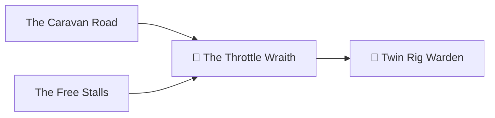

*It never appears in the first five minutes. The benchmark looks fine, the game feels smooth, and you call the build a success. Then, twenty minutes in, the heat finally soaks through the metal. Clocks sag. Frames stutter. Nothing crashes and no error appears, because the machine is protecting itself by stealing your speed. This is the Throttle Wraith, the quietest monster in the realm. No spell reveals it, and only a patient hero with a long log can see it.*

## 🎯 Quest Objectives

By the end of this chapter you will:

- [ ] **Stream a game** from the Great Rig to the Rewind Cabinet over your network
- [ ] **Log a 30-minute session** on the desktop with MangoHud
- [ ] **Analyze that log** with a script that compares the start and the end
- [ ] **Trace a slowdown to its cause** and fix it, changing one thing at a time
- [ ] **Publish your evidence** in a finished `twin-rigs` repository

## 🗺️ Quest Prerequisites

- **[Chapter IV](/quests/0101/twin-rigs-04-the-caravan-road/)** — the Rewind Cabinet working as a console
- **[Chapter VII](/quests/1000/twin-rigs-07-the-free-stalls/)** — the Great Rig stocked with games
- **Wired Ethernet on both rigs** — Wi-Fi can work, but it makes streaming problems harder to diagnose
- **A demanding game** — one that keeps your GPU busy for 30 minutes

## 🌍 Choose Your Adventure Platform

*Both rigs run Linux, and each has its own side of this fight.*

### 🐧 Linux

On the Rewind Cabinet, over SSH, install Valve's Steam Link client from the Raspberry Pi package archive:

```bash
sudo apt update && sudo apt install -y steamlink
```

Then, on the Great Rig in Game Mode, open **Settings**, then **Remote Play**, and turn it on.

## 🧙‍♂️ Chapter 1: Bridge the Two Rigs

### ⚔️ Skills You'll Forge

- Separating where a game runs from where you see it
- Testing network quality for real-time video

A Pi cannot run a modern game, but it can decode video well. With streaming, the Great Rig runs the game and sends each frame over your network, while your button presses travel the other way.


Leave the arcade by pressing Select and Start, exit ES-DE, and start the client from a terminal on the Pi's own screen:

```bash
steamlink
```

It should find the Great Rig on your network and show a PIN. Enter that PIN on the rig to pair them. Then start a game from the Pi.

Steam Link's streaming settings show live latency and bandwidth. If you see stutter, plug both rigs into Ethernet before you change anything else, since that fixes most problems. For the best results, connect them to the same switch or router.

> 🧭 **The open source road:** [Sunshine](https://github.com/LizardByte/Sunshine) and [Moonlight](https://moonlight-stream.org/) offer a fully open alternative. There is a catch on SteamOS: the Sunshine Flatpak cannot use KMS capture, so plan on Desktop Mode only and expect extra setup. Treat this as a side quest for after the boss.

### 🔍 Knowledge Check

- [ ] Which rig does the heavy graphics work during a stream?
- [ ] Why is Ethernet the first fix to try?

## 🧙‍♂️ Chapter 2: Set the Trap

### ⚔️ Skills You'll Forge

- Collecting performance data automatically
- Designing a measurement that can detect change over time

You cannot catch the wraith by watching, so make the machine write everything down. MangoHud comes with SteamOS. In Desktop Mode, make a folder for the logs:

```bash
mkdir -p ~/mangologs
```

In Steam, open your demanding game's **Properties** and set its **Launch Options** to the line below. It starts logging one second after launch and stops after 1,800 seconds, which is 30 minutes.

```text
MANGOHUD_CONFIG=output_folder=/home/deck/mangologs,autostart_log=1,log_duration=1800 mangohud %command%
```

Before you start the session, close the case and put the rig where it will really live. A rig tested on an open bench can pass, then throttle once it is shoved under a desk.

Play for at least 30 minutes without pausing. Keep the game in a heavy scene, because menus let the rig cool off and hide the wraith.

### 🔍 Knowledge Check

- [ ] Why must the case be closed during the test?
- [ ] What would a pause in the middle do to your results?

## 🧙‍♂️ Chapter 3: Read the Log

### ⚔️ Skills You'll Forge

- Parsing a CSV log with a script
- Comparing medians across time windows

Fighting the wraith means comparing the start of a session with its end. A single average hides exactly the slow fade you are looking for. Back on your fortress, in `twin-rigs`, save this as `wraith_check.py`:

```python
#!/usr/bin/env python3
"""Compare the start and end of a MangoHud log to catch sustained-load throttling."""
import csv
import statistics
import sys

rows = list(csv.reader(open(sys.argv[1])))
header = next(i for i, row in enumerate(rows) if row and row[0] == "fps")
names = rows[header]
data = [dict(zip(names, row)) for row in rows[header + 1:] if len(row) == len(names)]
quarter = len(data) // 4
if quarter < 100:
    sys.exit("Log too short. Play for the full 30 minutes, then run this again.")


def median(sample, column):
    return statistics.median(float(row[column]) for row in sample)


start, end = data[:quarter], data[-quarter:]
wraith = False
for column, label in (("fps", "Frame rate"), ("gpu_core_clock", "GPU clock")):
    if column not in names:
        print(f"SKIP  {label}: no {column} column in this log")
        continue
    first, last = median(start, column), median(end, column)
    drop = (first - last) / first * 100 if first else 0
    faded = drop > 15
    wraith = wraith or faded
    print(f"{'FAIL' if faded else 'PASS'}  {label}: {first:.0f} -> {last:.0f} ({drop:.1f}% drop)")

for column, label in (("gpu_temp", "GPU"), ("cpu_temp", "CPU")):
    if column in names:
        print(f"INFO  Peak {label} temperature: {max(float(r[column]) for r in data):.0f}C")

print("\nThe Throttle Wraith walks. Check airflow and fans." if wraith else "\nNo wraith in this log.")
sys.exit(1 if wraith else 0)
```

Bring the log home and run the check. With SSH running on the rig, as in Chapter VI:

```bash
mkdir -p evidence
scp 'deck@<rig-ip>:mangologs/*.csv' evidence/
python3 wraith_check.py evidence/your-log.csv
```

A clean run looks like this:

```text
PASS  Frame rate: 60 -> 60 (0.4% drop)
PASS  GPU clock: 2400 -> 2390 (0.4% drop)
INFO  Peak GPU temperature: 89C
INFO  Peak CPU temperature: 70C

No wraith in this log.
```

The 15% limit is a judgement call, and a frame-rate change can simply mean you walked into a different scene. That is why you read frame rate and GPU clock together. Falling clocks with rising heat are the true sign of the wraith.

### 🔍 Knowledge Check

- [ ] Why compare the first and last quarters instead of using one average?
- [ ] A frame rate falls but the GPU clock holds steady. What might that mean?

## 🧙‍♂️ Chapter 4: Banish the Wraith

### ⚔️ Skills You'll Forge

- Reasoning from symptom to root cause
- Verifying a fix with the same test that found the fault

If the check fails, walk this table in order, starting with the free fixes. Change one thing, then repeat the full test.

| Sign | Likely cause | Try this |
|---|---|---|
| GPU clock falls, GPU temperature is high | Poor case airflow | Clear the intake filters, then check that fans pull in at the front and push out at the back |
| CPU temperature near its limit | Poor cooler contact or a weak fan curve | Check the `CPU_FAN` curve in firmware, and reseat the cooler if needed |
| Rig restarts under load | Power delivery | Reseat the GPU cables, and check the PSU rating against the GPU maker's advice |
| Fine on the bench, hot in place | No room to breathe | Move the rig away from the wall and out of any closed cabinet |

Then repeat the fight on the Rewind Cabinet. Reboot it to clear the "since boot" flags, and run the Chapter II vigil for 30 minutes this time, so both rigs face the same trial:

```bash
sudo reboot
# After it comes back, connect again:
stress-ng --cpu 4 --timeout 30m
vcgencmd get_throttled
```

Look for `throttled=0x0` when it finishes. If a flag has appeared, use the bit table from Chapter II to tell heat from power.

### 🔍 Knowledge Check

- [ ] Why rerun the whole 30 minutes after a fix?
- [ ] Why reboot the Pi before the test?

## ⚔️ The Boss Fight

**Objective:** Defeat the Throttle Wraith on both rigs, and leave proof that anyone can check.

**Success Criteria:**

- [ ] A game streams from the Great Rig to the Pi and plays with a gamepad
- [ ] `wraith_check.py` passes on a real 30-minute log from the closed case
- [ ] The Pi reports `throttled=0x0` after its 30-minute vigil
- [ ] Fresh reports from both rigs are in `reports/`
- [ ] Your `README.md` explains what you built, what broke, and how you fixed it

Take a final report from both rigs with `rig-report.sh`, then seal the chronicle:

```bash
git add README.md wraith_check.py evidence reports
git commit -m "docs: record the Throttle Wraith's defeat"
```

To share your work, publish `twin-rigs` as a public repository. Before you do, make sure it holds no game files, passwords, or personal details. Your IP addresses and hostnames are worth a look too.

## 🔍 Quest Network



## 🎁 Rewards & Progression

- 🐉 **Wraith Banisher** — proved sustained performance on both rigs with logged evidence
- 👑 **Twin Rig Warden** — completed the campaign
- ⚡ **Skills unlocked:** game streaming, performance logging, root-cause analysis, evidence-based tuning
- 🏆 **200 XP** toward the campaign

*Chapters sit at different levels by design: the campaign uses the level number for progression, and each chapter also appears on its own level hub.*

## 🔮 Next Adventures

You built two machines, and you can now prove what they do. Where you go next is up to you:

- 🎨 Make your own game for the rigs with [Godot](https://godotengine.org/), which exports to Linux
- 🔧 Add a console to Rewind Arcade: [one YAML file](https://github.com/bamr87/rewind-arcade/blob/main/emulate/docs/adding-systems.md) is all it takes, and a pull request earns you some karma
- 🛰️ Set up the Sunshine and Moonlight side road from Chapter 1
- ⬅️ **Previous chapter:** [Chapter VII — The Free Stalls](/quests/1000/twin-rigs-07-the-free-stalls/)
- 👑 **Campaign hub:** [Epic Quest: The Twin Rigs](/quests/codex/twin-rigs/)

## 📚 Resource Codex

- [MangoHud](https://github.com/flightlessmango/MangoHud) — the logging options and CSV format used here
- [Steam Remote Play](https://store.steampowered.com/remoteplay) — how Valve's streaming works
- [Sunshine](https://github.com/LizardByte/Sunshine) and [Moonlight](https://moonlight-stream.org/) — the open source streaming pair
- [Raspberry Pi thermal docs](https://www.raspberrypi.com/documentation/computers/raspberry-pi.html) — when and how the Pi throttles

## 🕸️ Knowledge Graph

*Structured wiki-links connect this quest to the IT-Journey knowledge graph. Open the [Obsidian Graph View](/notes/obsidian/graph/) to explore connections.*

**Campaign hub:** [[Epic Quest: The Twin Rigs]] **Level hub:** [[Level 1001 (9) - Kubernetes Orchestration]] **Previous:** [[The Free Stalls: Stock SteamOS with Open Source Games]] **Next:** none — final chapter **Obsidian docs:** [[Obsidian Knowledge Graph and Wiki Links]]
