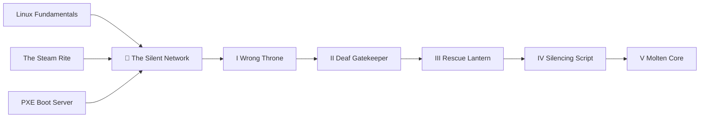

*The cable is in. The link lights blink green. The router has handed out an address. And the screen says, calmly, **No networks found**. You reboot; it says it again. You reinstall; it says it again. Somewhere between the firmware and the welcome screen, something is listening for your network and then quietly putting its hands over its ears.*

*This campaign is built from a real night of debugging a new SteamOS desktop. Every log line in it is real. So are the wrong turns: three of them looked convincing at the time. You will learn the causes, but the real loot is the method that found them, which works on any machine that boots.*

## 📜 Quest Metadata

| Field | Value |
|---|---|
| **Campaign** | The Silent Network |
| **Chapters** | 5, from Level 0111 to Level 1010 |
| **Time** | 10-14 hours across several sessions |
| **The machine** | ASUS ROG Crosshair X870E Dark Hero, AMD RX 9070 XT, 2 TB NVMe, wired Ethernet |
| **The symptom** | SteamOS first-time setup: *Choose your network → No networks found*, and no OS updates |
| **Portfolio artifact** | A field report: timeline, causes, fixes, wrong turns, and an upstream comment |

## 🎯 Quest Objectives

By the end of the campaign you will:

- [ ] **Prove which system booted** — disk, A/B slot, and firmware boot entry — before changing anything
- [ ] **Distrust your own instruments** and check that a "running" server is actually listening
- [ ] **Read the logs of a system that is not running** from a rescue system with SSH
- [ ] **Trace a failure through a service, a D-Bus call, and a shell script** to the exact line that breaks it
- [ ] **Fix an installed system before its first boot** through its `/etc` overlay
- [ ] **Match drivers to kernels** and choose an update path instead of fighting a read-only OS
- [ ] **Add evidence to an upstream bug report** in a way maintainers can use

## 🗺️ Quest Prerequisites

- **A Linux terminal and SSH** — see [Linux Fundamentals](/quests/0000/linux-fundamentals/)
- **SteamOS installed once, the normal way** — see [The Steam Rite](/quests/0111/twin-rigs-06-the-steam-rite/), whose last step ("connect to your network, sign in, and let it update") is where this campaign begins
- **Network boot basics** help in Chapters II and III — see [Summon Machines From the Wire](/quests/1000/pxe-boot-server/)

## 🧭 The Shape of the Campaign

Five problems were stacked on top of each other. Each one hid the next.

| Layer | What went wrong | Why it hid the others |
|---|---|---|
| 🔌 Firmware | The PC kept booting the recovery card instead of the installed drive | Every "fix" and "update" landed on the wrong system |
| 📡 Your own server | The PXE server's DHCP listener had died while its status page said *running* | The PC looked like it had no network at all |
| 🔦 Evidence | The install could not be reached, so its logs were out of sight | Theories piled up faster than facts |
| 📜 A helper script | Steam's first-boot Wi-Fi switch stopped NetworkManager and never restarted it | Ethernet died a few seconds after it came up |
| 🌋 The kernel | The board's Wi-Fi chip has no driver in SteamOS's kernel | Turned one helper script's edge case into this PC's every boot |

## 📖 The Chapters

Each chapter is its own quest, listed on its level hub and on this page.

| # | Chapter | Level | Difficulty | XP | You finish with |
|---|---|---|---|---|---|
| I | [The Wrong Throne](/quests/0111/silent-network-01-the-wrong-throne/) | 0111 | 🟡 Medium | 60 | Proof of which disk, slot, and boot entry are running |
| II | [The Deaf Gatekeeper](/quests/1000/silent-network-02-the-deaf-gatekeeper/) | 1000 | 🟡 Medium | 60 | A server that survives its own errors, and a habit of checking sockets |
| III | [The Rescue Lantern](/quests/1001/silent-network-03-the-rescue-lantern/) | 1001 | 🔴 Hard | 100 | An offline system's journal, read over SSH |
| IV | [The Silencing Script](/quests/1010/silent-network-04-the-silencing-script/) | 1010 | 🔴 Hard | 120 | The root cause, a pre-boot fix, and a log line that proves it |
| V | [The Molten Core](/quests/1010/silent-network-05-the-molten-core/) | 1010 | 🔴 Hard | 100 | Drivers matched to kernels, and Wi-Fi through the update channel |

## 🧾 The Field Chronicle

How the night actually went, condensed. Read it now for the shape; you'll understand every line by the last chapter.

| Step | What we believed | What was true | What settled it |
|---|---|---|---|
| 1 | "SteamOS is installed and has no network" | The PC was running the **recovery card** | `findmnt -no SOURCE /` → `/dev/sdc3` |
| 2 | "Updates are broken" | Updates need a second system slot; the card has one | `Destination device '/dev/disk/by-partsets/B/rootfs' … not found` |
| 3 | "I booted the M.2 several times" | Four boots, all from the card's firmware entry | `efibootmgr` → `BootCurrent: 0005` (USB) |
| 4 | "The PC's network port is dead" | The **server** had stopped listening | `lsof` showed UDP 4011 and 69, but not 67 |
| 5 | "It's the Wi-Fi backend setting; flip it" | Steam rewrites that setting every boot | File modified 9 s into the next boot |
| 6 | "The disk is corrupt" | Someone was reinstalling it at that moment | `repair_device.sh all` in the journal, `dd … of=/dev/nvme0n1p4` in `ps` |
| 7 | The root cause | A helper stops NetworkManager, then fails before restarting it | `Error setting wifi backend: Exited 254` |
| 8 | The fix | A guard that restarts NetworkManager, placed before first boot | `NetworkManager was stopped; starting it`, then `connected:full` |

Rows 4, 5 and 6 are **Plausible Ghosts**: confident readings that were wrong. Each one came from looking at a symptom instead of an instrument.

## 🐉 The Boss Gate

The boss of this campaign is not a bug. It is the urge to fix before you know. To pass the gate, your field report must show:

- [ ] Each cause, with the exact command output or log line that proves it
- [ ] At least one wrong turn, with what disproved it
- [ ] A fix you verified by a log line, not by a screen looking better
- [ ] A comment or report upstream that adds evidence, not just agreement

## 🔍 Quest Network

## 🎁 Rewards & Progression

Finish every chapter and pass the Boss Gate to earn:

- 👑 **Network Whisperer** — took a silent network to a proven root cause and a fix
- 📜 **Petition Bearer** — added evidence to an upstream bug report instead of a complaint
- ⚡ **Skills unlocked:** boot forensics, A/B system slots, offline log reading, systemd and NetworkManager internals, overlay filesystems, kernel driver archaeology, and upstream bug etiquette

## 🔮 Next Adventures

- 🧭 **Begin the campaign:** [Chapter I — The Wrong Throne](/quests/0111/silent-network-01-the-wrong-throne/)
- 🕹️ **Build the rig first:** [The Twin Rigs](/quests/codex/twin-rigs/)
- 📡 **Master network boot:** [Summon Machines From the Wire](/quests/1000/pxe-boot-server/)

## 📚 Resource Codex

- [SteamOS issue #2514](https://github.com/ValveSoftware/SteamOS/issues/2514) — *OOBE Cannot Proceed on Ethernet-Only Systems*, the upstream report for Chapter IV
- [SteamOS Installation and Repair](https://help.steampowered.com/en/faqs/view/65B4-2AA3-5F37-4227) — Valve's recovery image and install guide
- [NetworkManager documentation](https://networkmanager.dev/docs/) — the daemon at the center of Chapter IV
- [systemd.unit](https://www.freedesktop.org/software/systemd/man/latest/systemd.unit.html) and [journalctl](https://www.freedesktop.org/software/systemd/man/latest/journalctl.html) — the tools of Chapters III and IV

## 🕸️ Knowledge Graph

*Structured wiki-links connect this quest to the IT-Journey knowledge graph. Open the [Obsidian Graph View](/notes/obsidian/graph/) to explore connections.*

**First chapter:** [[The Wrong Throne: Prove Which System Booted]] **Final chapter:** [[The Molten Core: Match Drivers to Kernels]] **Related epic:** [[Epic Quest: The Twin Rigs]] **Codex:** [[Codex Glossary: Fantasy Terms to IT Reality]] **Obsidian docs:** [[Obsidian Knowledge Graph and Wiki Links]]
