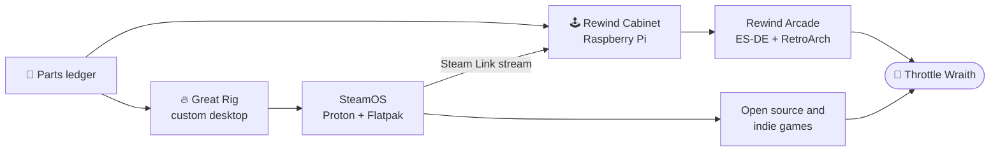
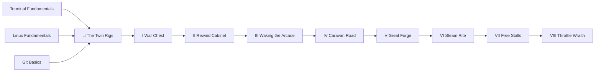

*Two rigs. One fits in your palm and remembers every cartridge you ever blew dust out of. The other stands on the floor, breathes through three fans, and runs the living library of Steam on an operating system you can read the source of. Most players buy one box and stop there. You will forge both from parts, make them speak to each other, and then hunt the one monster that hides from every quick test.*

*This is not a shopping list. By the last chapter you will know why each part is in the box, how to prove it is healthy, and what to do when it isn't. Those skills outlast any graphics card.*

## 📜 Quest Metadata

| Field | Value |
|---|---|
| **Campaign** | The Twin Rigs |
| **Chapters** | 8, running from Level 0010 to Level 1001 |
| **Time** | 20-30 hours across several sessions, plus shipping time for parts |
| **Rig one** | Raspberry Pi running [Rewind Arcade](https://github.com/bamr87/rewind-arcade) (ES-DE, RetroArch, and a browser arcade) |
| **Rig two** | A custom desktop running SteamOS, stocked with open source and indie games |
| **Portfolio artifact** | A `twin-rigs` repository holding your parts ledger, health reports, and boss-fight evidence |

## 🎯 Quest Objectives

By the end of this campaign you will have:

- [ ] **Planned two builds on paper** — a parts ledger that a script checks for the mistakes that cost real money
- [ ] **Built the Rewind Cabinet** — a cooled, tested Raspberry Pi that survives a sustained load without throttling
- [ ] **Woken Rewind Arcade** — ES-DE and RetroArch running a legal homebrew game, from a repository you can read and change
- [ ] **Made the Pi a console** — it boots straight to the game list, takes a gamepad, and has its saves backed up
- [ ] **Forged the Great Rig** — a desktop you assembled, tested, and tuned in the BIOS yourself
- [ ] **Installed SteamOS** — on a dedicated drive, using Valve's own image and instructions
- [ ] **Stocked it with free games** — open source and indie titles from Flathub, launched from Game Mode
- [ ] **Banished the Throttle Wraith** — logged proof that both rigs hold their speed under a long load, and the desktop streaming to the Pi

## 🗺️ Quest Prerequisites

- **Terminal comfort** — you can move between folders, run commands, and read errors. The [Terminal Fundamentals](/quests/0000/terminal-fundamentals/) quest covers this.
- **A little Linux** — both rigs run Linux. [Linux Fundamentals](/quests/0000/linux-fundamentals/) is the right warm-up.
- **Git basics** — you will keep your ledger and reports in a repository. See [Git Basics](/quests/0000/git-basics/).
- **A second computer** — your fortress, used to flash drives and to reach the Pi over SSH.
- **A real budget** — you are buying physical parts. Chapter I prices them before you spend anything, and you can play the Pi half alone for a fraction of the cost.
- **A patient afternoon** — no soldering is required, and nothing here needs prior hardware experience.

> ⚠️ **Read before you buy:** Valve lists AMD discrete GPUs under *Beta SteamOS Support*. NVIDIA cards are not on that list, and Valve's support team may have limited ability to help with hardware outside its official devices. The SteamOS installer also wipes the device it runs on. Chapters I and VI show you how to plan around both. These facts were checked in November 2026, and SteamOS moves quickly, so read [Valve's install page](https://help.steampowered.com/en/faqs/view/65B4-2AA3-5F37-4227) before you buy a graphics card.

## 🧭 The Shape of the Campaign

The two rigs do different jobs, and the campaign keeps them apart until the final chapter joins them over your home network.

| | 🕹️ Rewind Cabinet | 🔥 Great Rig |
|---|---|---|
| **Job** | Retro games and the browser arcade, under the TV | Modern, indie, and open source games |
| **CPU type** | Arm (`aarch64`) | x86-64 |
| **Operating system** | Raspberry Pi OS (Debian) | SteamOS (Arch-based, read-only root) |
| **Software comes from** | `apt` and the `retropi` tool | Steam and Flathub |
| **Biggest risk** | Weak power, heat | Wrong GPU vendor, a wiped drive |

## 📖 The Chapters

Play them in order. If you only want one rig, Chapters I to IV finish the Pi, and Chapters I and V to VII finish the desktop. The boss fight needs both.

| # | Chapter | Level | Difficulty | XP | You finish with |
|---|---|---|---|---|---|
| I | [The War Chest](/quests/0010/twin-rigs-01-the-war-chest/) | 0010 | 🟢 Easy | 40 | A checked parts ledger |
| II | [The Rewind Cabinet](/quests/0011/twin-rigs-02-the-rewind-cabinet/) | 0011 | 🟡 Medium | 60 | A healthy, stress-tested Pi |
| III | [Waking the Arcade](/quests/0100/twin-rigs-03-waking-the-arcade/) | 0100 | 🟡 Medium | 80 | A homebrew game running in ES-DE |
| IV | [The Caravan Road](/quests/0101/twin-rigs-04-the-caravan-road/) | 0101 | 🟡 Medium | 80 | A Pi that behaves like a console |
| V | [The Great Forge](/quests/0110/twin-rigs-05-the-great-forge/) | 0110 | 🔴 Hard | 120 | An assembled, memory-tested desktop |
| VI | [The Steam Rite](/quests/0111/twin-rigs-06-the-steam-rite/) | 0111 | 🔴 Hard | 120 | SteamOS installed and reported |
| VII | [The Free Stalls](/quests/1000/twin-rigs-07-the-free-stalls/) | 1000 | 🟡 Medium | 80 | An open source game library |
| VIII | [The Throttle Wraith](/quests/1001/twin-rigs-08-the-throttle-wraith/) | 1001 | ⚔️ Epic | 200 | Streaming, plus proof under load |

*Chapters sit at different levels by design. The campaign uses the level number for progression, so a chapter's topic will not always match the theme of its level hub.*

## 🐉 The Boss Gate

You reach the **Throttle Wraith** in Chapter VIII, and you cannot beat it with a screenshot. A rig that feels fast for five minutes can slow itself down at minute twenty, when the heat finally soaks through. The wraith is real: it is the thermal and power throttling that protects your hardware by quietly stealing your speed.

To win, you must show:

- [ ] A Pi that finishes a sustained load with clean throttle flags
- [ ] A 30-minute desktop log where the frame rate and GPU clock hold steady
- [ ] A game streamed from the Great Rig to the Rewind Cabinet
- [ ] All of that evidence committed to your `twin-rigs` repository

## 🔍 Quest Network

## 🎁 Rewards & Progression

Finish every chapter and defeat the wraith to earn:

- 👑 **Twin Rig Warden** — built, tested, and connected both rigs
- 🐉 **Wraith Banisher** — proved sustained performance with logged evidence
- ⚡ **Skills unlocked:** hardware planning, PC assembly, Linux on Arm, emulation tooling, immutable operating systems, Flatpak, game streaming, and performance diagnosis

Your real loot is the `twin-rigs` repository, and two machines you can repair yourself.

## 🔮 Next Adventures

- 🕹️ **Begin the campaign:** [Chapter I — The War Chest](/quests/0010/twin-rigs-01-the-war-chest/)
- 🐚 **Sharpen your shell:** [Bash Scripting](/quests/0010/bash-scripting/)
- 🏛️ **Raise another epic:** [The Relic Raisers](/quests/codex/relic-raisers/)

## 📚 Resource Codex

- [Rewind Arcade](https://github.com/bamr87/rewind-arcade) — the retro workspace at the heart of the Pi build, with a [playable browser arcade](https://bamr87.github.io/rewind-arcade/)
- [SteamOS Installation and Repair](https://help.steampowered.com/en/faqs/view/65B4-2AA3-5F37-4227) — Valve's official guide and hardware support table
- [Raspberry Pi documentation](https://www.raspberrypi.com/documentation/computers/raspberry-pi.html) — power, cooling, and boot details
- [SteamOS issue tracker](https://github.com/ValveSoftware/SteamOS) — where Valve tracks compatibility reports
- [Flathub](https://flathub.org/) — where the open source games in Chapter VII come from

## 🕸️ Knowledge Graph

*Structured wiki-links connect this quest to the IT-Journey knowledge graph. Open the [Obsidian Graph View](/notes/obsidian/graph/) to explore connections.*

**First chapter:** [[The War Chest: Plan Two Rigs Before You Spend a Coin]] **Final chapter:** [[The Throttle Wraith: Prove Both Rigs Under Sustained Load]] **Codex:** [[Codex Glossary: Fantasy Terms to IT Reality]] **Obsidian docs:** [[Obsidian Knowledge Graph and Wiki Links]]
